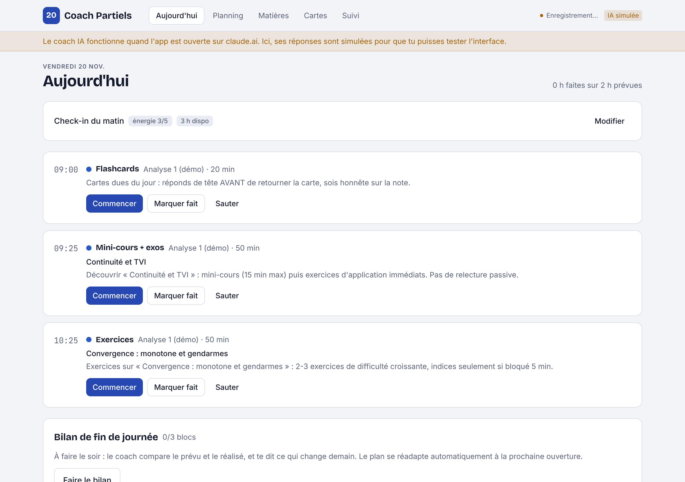
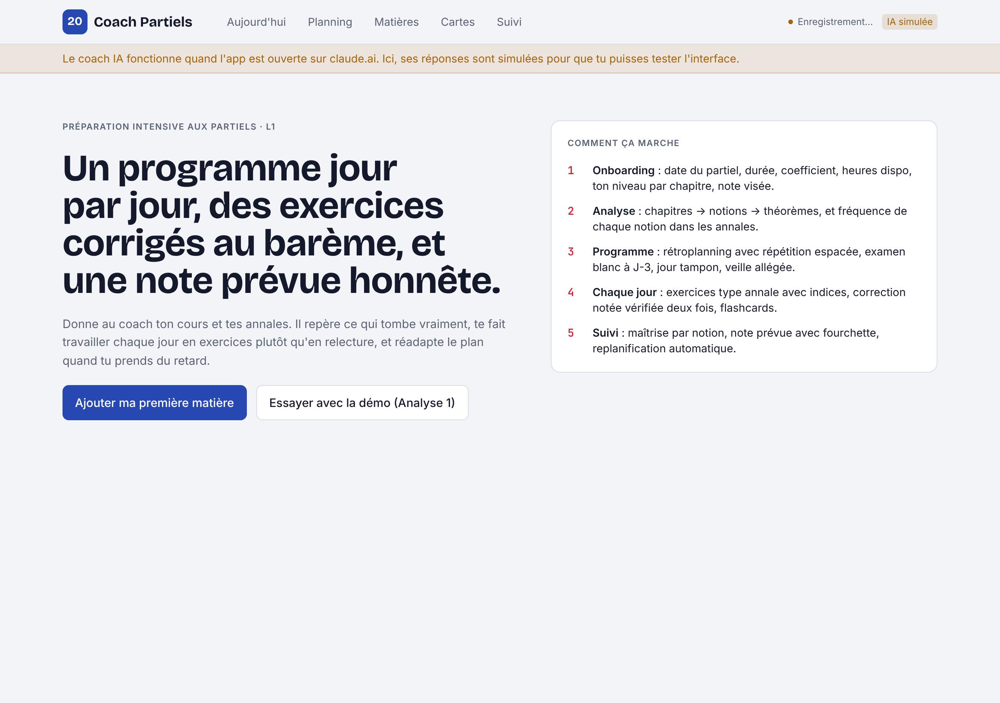
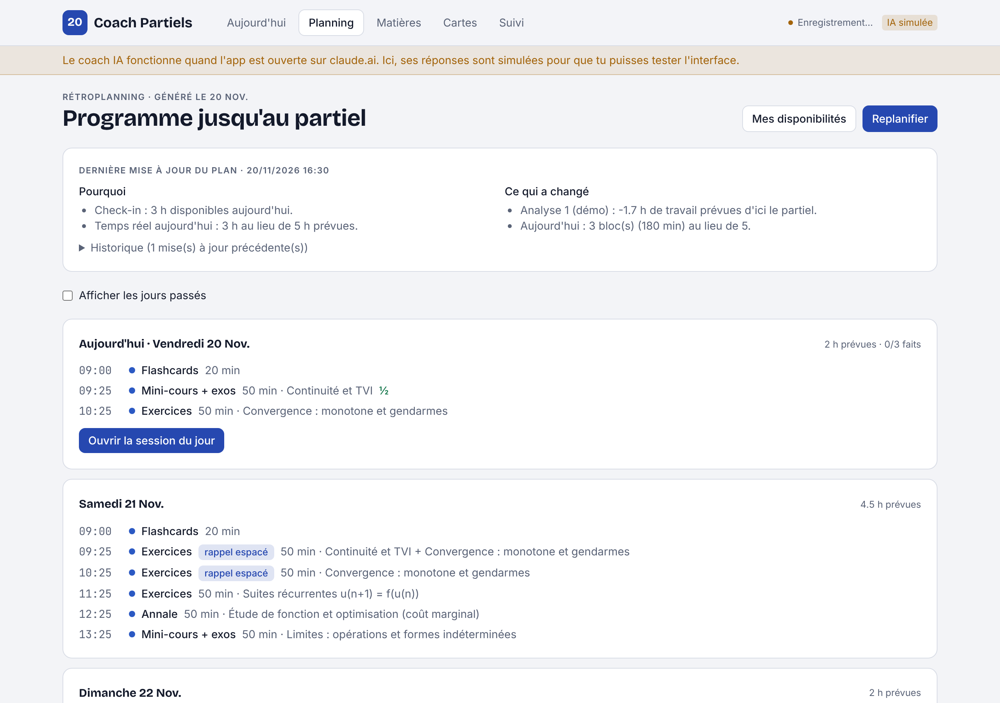
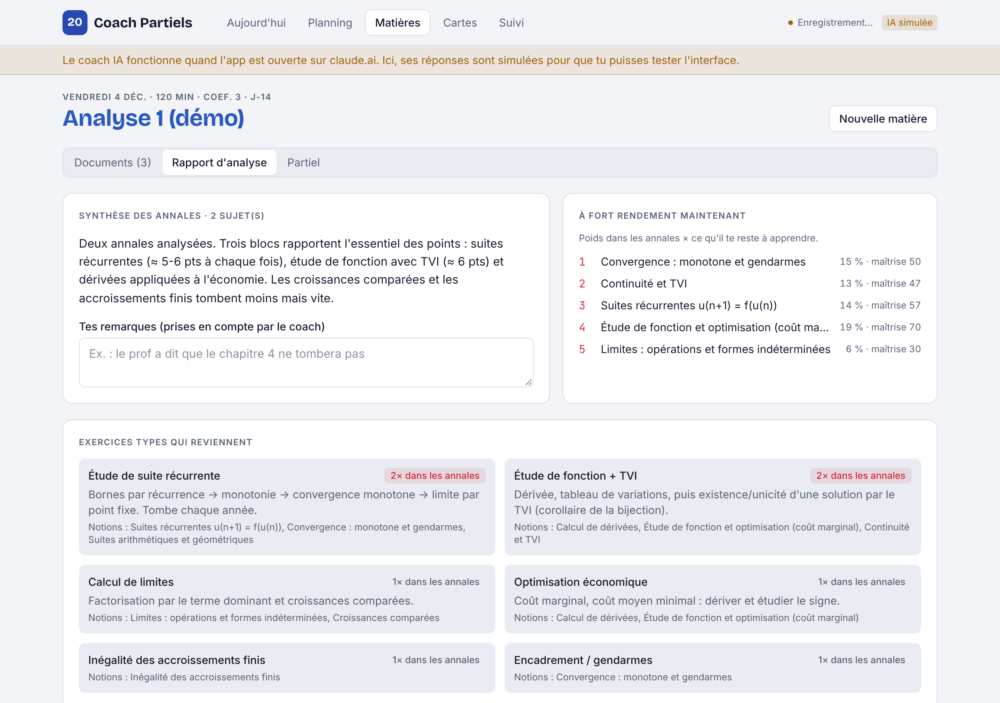
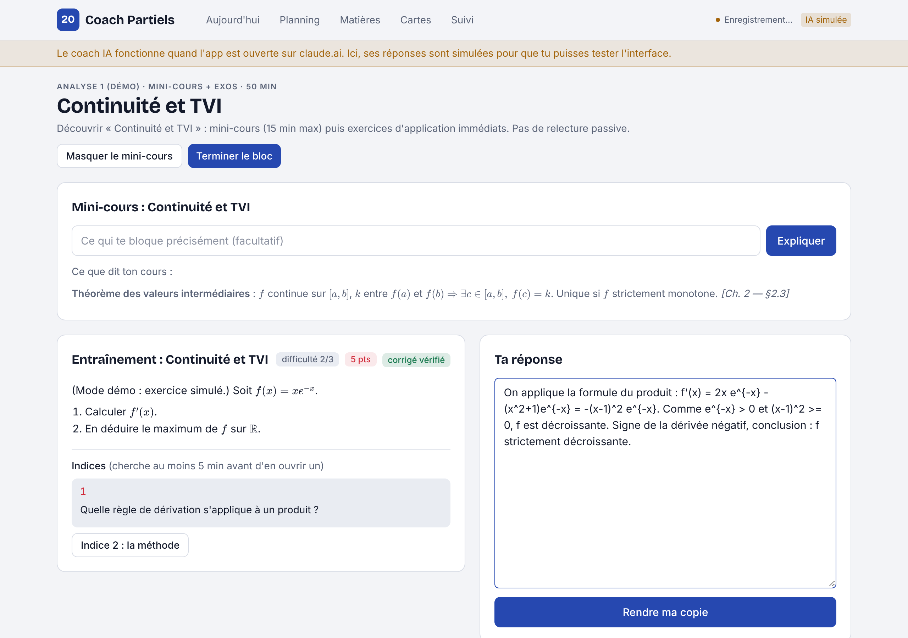
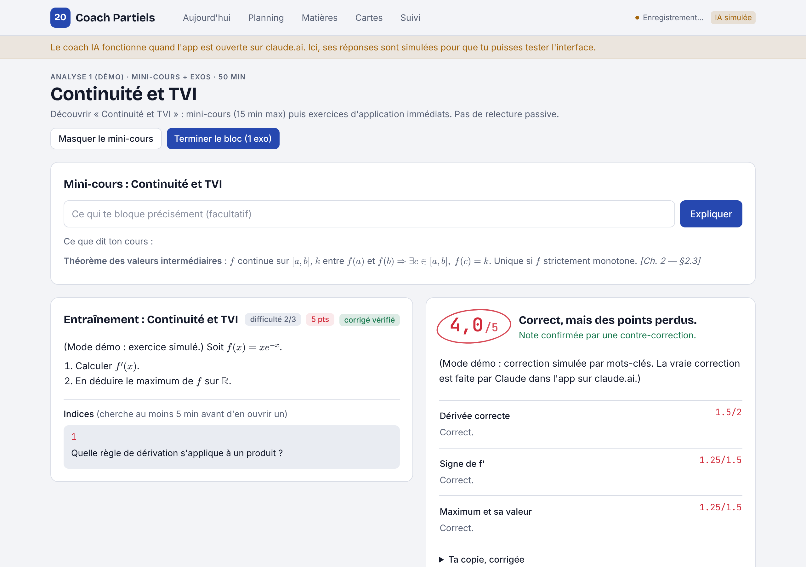
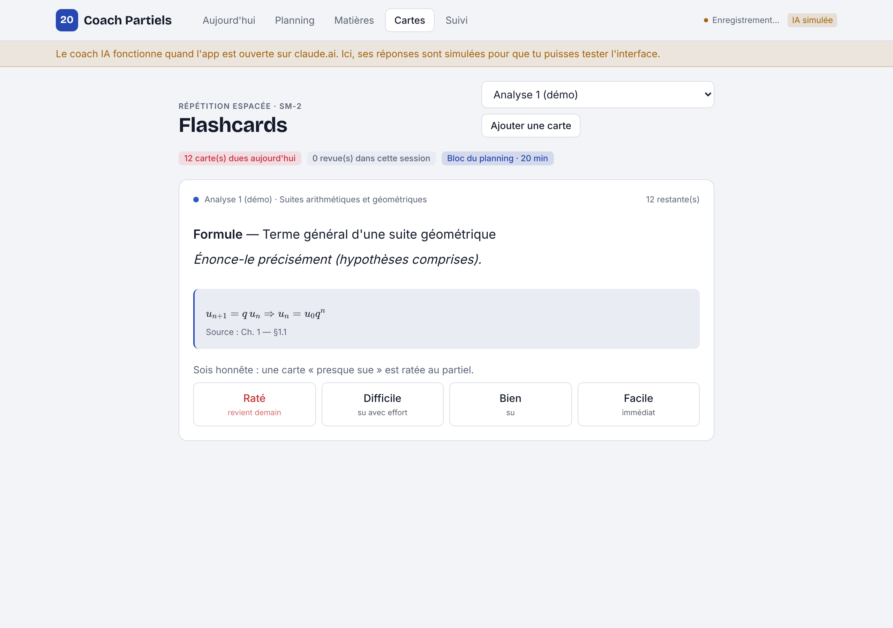
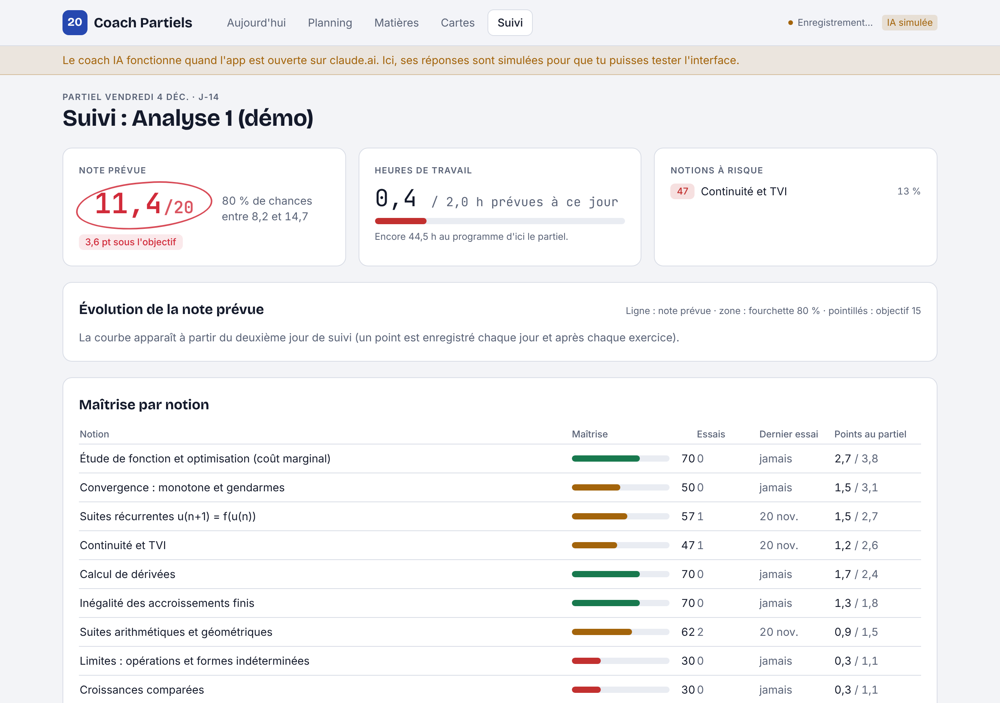
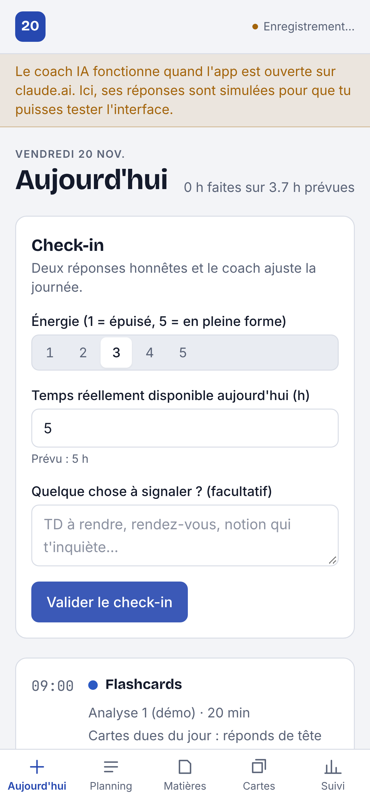

# Coach Partiels

Application de coaching IA pour préparer les partiels de L1 (maths, économie, stats…). Tu lui donnes ton cours et tes annales. En retour, le coach :

- repère ce qui tombe vraiment (fréquence et points de chaque notion dans les annales) ;
- construit un programme jour par jour jusqu'au partiel, avec répétition espacée, alternance des notions, examen blanc à J-3, jour tampon et veille allégée. Si le temps manque, il te le dit et propose un plan « triage » ;
- te fait travailler chaque jour : exercices type annale avec 3 niveaux d'indices, correction notée au barème puis vérifiée une seconde fois, flashcards SM-2, mini-cours tirés de ton cours, examen blanc chronométré noté sur 20 ;
- suit ta maîtrise par notion, prévoit ta note avec une fourchette et une formule expliquée, et replanifie quand tu prends du retard.



## Utilisation : aucune installation, aucune clé API

L'app est publiée comme **page claude.ai privée** (un « Artifact »). Ouvre son lien, sur ordinateur ou téléphone, en étant connecté à ton compte Claude :

1. Au premier appel IA, claude.ai te demande d'**autoriser la page à utiliser Claude**. Accepte : l'IA tourne sur ton compte.
2. Tes données (matières, progression, documents) sont enregistrées **en ligne, en privé** dans ton espace (`data/users/<toi>/…`). Personne d'autre ne les voit, même si tu partages le lien. Une copie de secours est aussi gardée dans le navigateur.
3. Commence par **« Ajouter ma première matière »**, puis importe ton cours et tes annales.

### Coût

- **0 € de plus.** Il n'y a pas de clé API Anthropic à payer : chaque appel compte simplement dans les limites d'usage de ton abonnement Claude, comme un message dans le chat.
- Ordre de grandeur des appels, pour savoir ce qui consomme :

| Action | Appels | Modèle |
|---|---|---|
| Analyse d'un cours + annales | 2 (gros) | le plus puissant (Opus) |
| Exercice généré | 2 (rédaction + vérification) | Sonnet |
| Correction d'une copie | 2 (correction + contre-correction) | Sonnet |
| Mini-cours | 1 | Sonnet |
| Examen blanc | 1 génération + 2 par exercice corrigé | Opus puis Sonnet |
| Check-in / bilan | 1 chacun | modèle rapide |
| Flashcards, planning, maîtrise, prévision | **0** (calculé dans la page) | — |

  Une journée type (check-in, 4 à 6 exercices corrigés, bilan) fait environ 15 à 25 appels. Si tu atteins la limite de ton abonnement, l'app te le dit, ne perd rien, et tu réessaies plus tard.
- Si ton compte n'a pas accès à un modèle nommé, claude.ai répond automatiquement avec le niveau le plus proche.

## Développement local

```bash
npm install
npm run dev        # http://localhost:5173 (IA simulée, sauvegarde dans le navigateur, bouton « Charger les données de test »)
npm test           # tests unitaires (planning, SM-2, maîtrise, prévision, vérification maths…)
npm run build      # vérifie les types, construit dist/index.html (fichier unique) et artifact/coach-partiels.html
npm run e2e        # après le build : parcours complet dans Chromium (Playwright requis)
```

Hors claude.ai, la page ne peut pas appeler Claude : un bandeau l'indique et **toutes les réponses IA sont simulées** (déterministes) pour que l'interface reste testable. La logique (planning, flashcards, maîtrise, prévision) est, elle, identique.

Pour republier après une modification : `npm run build`, puis publier `artifact/coach-partiels.html` comme Artifact claude.ai avec les capacités `sample` (images autorisées), `db` et `user`.

## Écrans

| | |
|---|---|
|  Accueil |  Planning et triage |
|  Rapport d'analyse modifiable |  Exercice avec indices |
|  Correction au barème, vérifiée |  Flashcards SM-2 |
|  Suivi et prévision expliquée |  Sur téléphone |

## Architecture

```
src/
  lib/
    planner.ts     rétroplanning déterministe (priorité, triage, espacement, alternance, multi-matières)
    replan.ts      détection du retard / des notions qui stagnent, diff « ce qui a changé et pourquoi »
    sm2.ts         algorithme SM-2 (+ plafonnement avant le partiel)
    mastery.ts     maîtrise par notion (a priori + essais pondérés + oubli)
    forecast.ts    note prévue + fourchette 80 %
    analysis.ts    poids des notions depuis les annales, exercices types, flashcards depuis le cours
    mathcheck.ts   vérification symbolique/numérique (mathjs) des dérivées, limites, égalités
    ai/client.ts   appels Claude (JSON validé par Zod + 1 réparation, streaming, erreurs en français)
    ai/tasks.ts    prompts : onboarding, analyse, exercice, correction, contre-correction, mini-cours, examen blanc, coach
    ingest.ts      PDF (texte via pdf.js, scanné via la vision de Claude), photos, .txt/.md
    store.tsx      état, sauvegarde automatique (claude.ai + copie locale), routine quotidienne
  pages/           Accueil, Onboarding, Matière, Planning, Aujourd'hui, Exercice, Flashcards, Examen blanc, Suivi
tests/             tests Vitest de la logique critique
scripts/           packaging de la page claude.ai, test de bout en bout
```

Les choix et limites connues sont détaillés dans [DECISIONS.md](DECISIONS.md).
