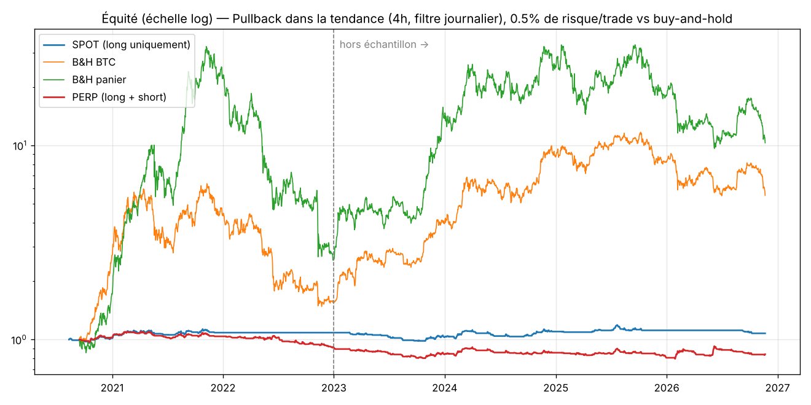

# Essai n°1 — Pullback dans la tendance (4h, filtre journalier)

_Généré le 2026-11-22 00:47 UTC par `uv run python scripts/backtest_pullback.py`. Aucun chiffre n'est saisi à la main._

## Règles (figées avant toute exécution)

- Régime journalier : close_1j > EMA50_1j > EMA200_1j (miroir pour le short, perp seul).
- Tendance 4h : EMA20 > EMA50, EMA20 montante, close > EMA50.
- Déclencheur : bougie précédente clôturée sous l'EMA20, bougie courante clôturée au-dessus et haussière.
- Stop : plus bas des 5 dernières bougies − 0,25 ATR ; risque entre 0,5 et 3 ATR.
- Gestion : 50 % à +2R, stop au point mort, reste en suiveur 3 ATR ; sortie après 30 bougies si +2R non atteint.
- Paramètres par défaut : `PullbackParams(ema_fast=20, ema_slow=50, d_fast=50, d_slow=200, lookback=5, stop_buffer_atr=0.25, min_risk_atr=0.5, max_risk_atr=3.0, tp1_r=2.0, tp1_frac=0.5, trail_atr=3.0, time_stop_bars=30, allow_short=False)`

## Hypothèses d'exécution

- Données : archives officielles Binance (data.binance.vision).
- Signal à la clôture, **entrée à l'ouverture suivante**. Stop/objectif touchés dans la même bougie : **stop supposé en premier**. Gap au-delà du stop : sortie à l'ouverture.
- Coûts spot : taker 0,10 %, maker 0,10 %, slippage 0,05 % (×2 sur les stops). Perp : taker 0,05 %, maker 0,02 %, même slippage, **funding réel** historique.
- Portefeuille : 0.5% du capital risqué par trade, risque ouvert total ≤ 1,5 % (BTC/ETH/SOL sont corrélés), notionnel ≤ 1× le capital (aucun levier). Équité valorisée chaque jour au prix de marché.
- Les statistiques de trades couvrent tout l'historique de chaque actif ; le portefeuille commun démarre quand les 3 actifs ont des données (SOL : août 2020 en spot, sept. 2020 en perp).
- In-sample : début → 2022-12-31. **Hors échantillon (OOS) : 2023-01-01 → fin.**

**Critères d'activation (fixés avant exécution)** : `min_oos_trades=30`, `min_oos_expectancy_r=0.05`, `min_oos_profit_factor=1.15`, `wf_expectancy_positive=1`, `max_oos_drawdown=-0.1`

## SPOT (long uniquement)

### Statistiques de trades

| Actif | Période | Trades | Win rate | Espérance nette R [IC 95 %] | Espérance brute R | Profit factor | Total R | Durée moy. (bougies 4h) |
|---|---|---|---|---|---|---|---|---|
| BTCUSDT | IS | 49 | 43% | -0.011 [-0.41 ; +0.43] | +0.082 | 0.98 | -0.6 | 19 |
| BTCUSDT | OOS | 71 | 38% | +0.150 [-0.24 ; +0.59] | +0.298 | 1.25 | +10.6 | 20 |
| ETHUSDT | IS | 59 | 44% | +0.163 [-0.23 ; +0.61] | +0.231 | 1.29 | +9.6 | 19 |
| ETHUSDT | OOS | 59 | 32% | -0.233 [-0.56 ; +0.15] | -0.125 | 0.67 | -13.8 | 16 |
| SOLUSDT | IS | 30 | 37% | -0.027 [-0.48 ; +0.48] | +0.017 | 0.95 | -0.8 | 17 |
| SOLUSDT | OOS | 55 | 44% | +0.049 [-0.30 ; +0.42] | +0.115 | 1.09 | +2.7 | 18 |
| **Total** | IS | 138 | 42% | +0.060 [-0.19 ; +0.31] | +0.131 | 1.10 | +8.2 | 18 |
| **Total** | OOS | 185 | 38% | -0.003 [-0.23 ; +0.24] | +0.109 | 1.00 | -0.5 | 18 |

### Portefeuille vs buy-and-hold

| Série | CAGR | Volatilité | Sharpe | Sortino | Max drawdown | CAGR/MaxDD | Exposition |
|---|---|---|---|---|---|---|---|
| Stratégie IS | +3.5% | 5.9% | 0.60 | 0.96 | -5.4% | 0.65 | 27% |
| B&H BTC IS | +16.9% | 70.7% | 0.57 | 0.83 | -76.6% | 0.22 | 100% |
| B&H panier égal IS | +47.8% | 102.3% | 0.90 | 1.29 | -92.1% | 0.52 | 100% |
| Stratégie OOS | -0.2% | 5.7% | -0.01 | -0.01 | -9.7% | -0.02 | 25% |
| B&H BTC OOS | +38.5% | 46.3% | 0.93 | 1.44 | -53.0% | 0.73 | 100% |
| B&H panier égal OOS | +42.2% | 66.4% | 0.86 | 1.32 | -68.6% | 0.62 | 100% |
| Stratégie Total | +1.2% | 5.8% | 0.23 | 0.35 | -13.2% | 0.09 | 26% |
| B&H BTC Total | +29.9% | 56.8% | 0.74 | 1.11 | -76.6% | 0.39 | 100% |
| B&H panier égal Total | +44.6% | 83.8% | 0.86 | 1.27 | -92.1% | 0.48 | 100% |

_Comparer le CAGR brut est trompeur : la stratégie ne risque que 0.5% par trade et n'est investie qu'une partie du temps. La comparaison pertinente est le couple Sharpe / max drawdown (rendement par unité de risque)._

### Walk-forward (entraînement 24 mois → test 6 mois, glissant)

Grille : `{'tp1_r': [1.5, 2.0, 3.0], 'trail_atr': [2.0, 3.0, 4.0], 'time_stop_bars': [20, 30, 60]}` → 27 combinaisons. Critère de choix : espérance R maximale sur la fenêtre d'entraînement (≥ 15 trades).

| Test | Combinaison choisie | Esp. entraînement | Trades test | Esp. test |
|---|---|---|---|---|
| 2022-08-01 → 2023-01-28 | tp1_r=3.0, trail_atr=4.0, time_stop_bars=60 | +0.736 | 0 | +0.000 |
| 2023-01-28 → 2023-07-27 | tp1_r=3.0, trail_atr=4.0, time_stop_bars=60 | +0.519 | 21 | -0.428 |
| 2023-07-27 → 2024-01-23 | tp1_r=3.0, trail_atr=3.0, time_stop_bars=60 | +0.131 | 29 | +0.184 |
| 2024-01-23 → 2024-07-21 | tp1_r=2.0, trail_atr=4.0, time_stop_bars=60 | -0.074 | 28 | +0.187 |
| 2024-07-21 → 2025-01-17 | tp1_r=1.5, trail_atr=4.0, time_stop_bars=30 | -0.002 | 22 | +0.526 |
| 2025-01-17 → 2025-07-16 | tp1_r=1.5, trail_atr=4.0, time_stop_bars=30 | +0.116 | 12 | +0.906 |
| 2025-07-16 → 2026-01-12 | tp1_r=3.0, trail_atr=3.0, time_stop_bars=60 | +0.288 | 22 | -0.703 |
| 2026-01-12 → 2026-07-11 | tp1_r=2.0, trail_atr=4.0, time_stop_bars=30 | +0.199 | 0 | +0.000 |
| 2026-07-11 → 2026-11-20 | tp1_r=2.0, trail_atr=4.0, time_stop_bars=30 | +0.169 | 12 | -0.617 |

| Version | Trades | Win rate | Espérance nette R [IC 95 %] | Espérance brute R | Profit factor | Total R | Durée moy. (bougies 4h) |
|---|---|---|---|---|---|---|---|
| Walk-forward (paramètres choisis sans voir l'avenir) | 146 | 35% | +0.008 [-0.27 ; +0.30] | +0.120 | 1.01 | +1.1 | 27 |
| Paramètres par défaut, mêmes périodes | 185 | 38% | -0.003 [-0.23 ; +0.24] | +0.109 | 1.00 | -0.5 | 18 |

**Sensibilité (OOS, 27 combinaisons)** : espérance min -0.126 R, médiane -0.022 R, max +0.024 R ; **15% des combinaisons positives**.
_Lecture : si seule une petite « île » de paramètres est positive, c'est du surapprentissage ; un avantage réel résiste à des variations raisonnables._

### Comportement pendant les krachs

| Épisode | Trades ouverts | R net de ces trades | Variation équité stratégie | BTC sur la période |
|---|---|---|---|---|
| Krach COVID (2020-03-08) | 0 | +0.00 | n/d (avant le portefeuille commun) | -30.7% |
| Krach mai 2021 (2021-05-10) | 6 | -6.28 | -3.59% | -40.5% |
| Effondrement LUNA (2022-05-05) | 0 | +0.00 | +0.00% | -24.2% |
| Faillite FTX (2022-11-06) | 0 | +0.00 | +0.00% | -19.9% |
| Krach août 2024 (2024-08-01) | 0 | +0.00 | +0.00% | -13.3% |
| Liquidations oct. 2025 (2025-10-09) | 3 | -3.28 | -1.66% | -6.8% |

### Robustesse

- **Concentration (OOS)** : espérance sans les 3 meilleurs trades -0.103 R, sans les 5 meilleurs -0.155 R ; trade médian -1.043 R.
- **Coûts × 2** (frais et slippage) : espérance OOS -0.134 R, profit factor 0.81.
- **Coûts × 3** (frais et slippage) : espérance OOS -0.251 R, profit factor 0.68.
- **Par année d'entrée** : 2019 : -5.2 R (6) · 2020 : -0.5 R (50) · 2021 : +13.9 R (82) · 2023 : -10.4 R (58) · 2024 : +14.0 R (71) · 2025 : +3.2 R (43) · 2026 : -7.3 R (13)

### Verdict SPOT (long uniquement)

- ✅ ≥ 30 trades OOS
- ❌ espérance OOS ≥ 0.05 R
- ❌ profit factor OOS ≥ 1.15
- ✅ espérance walk-forward > 0
- ✅ max drawdown OOS > -10%

**→ NON ACTIVÉE** (IC 95 % de l'espérance OOS : [-0.226 ; +0.235] R)

## PERP (long + short)

### Statistiques de trades

| Actif | Période | Trades | Win rate | Espérance nette R [IC 95 %] | Espérance brute R | Profit factor | Total R | Durée moy. (bougies 4h) |
|---|---|---|---|---|---|---|---|---|
| BTCUSDT | IS | 82 | 34% | -0.159 [-0.44 ; +0.14] | -0.065 | 0.75 | -13.0 | 17 |
| BTCUSDT | OOS | 96 | 36% | +0.146 [-0.20 ; +0.54] | +0.255 | 1.24 | +14.0 | 19 |
| ETHUSDT | IS | 74 | 35% | -0.060 [-0.39 ; +0.30] | +0.031 | 0.91 | -4.4 | 18 |
| ETHUSDT | OOS | 108 | 31% | -0.254 [-0.51 ; +0.02] | -0.172 | 0.64 | -27.5 | 16 |
| SOLUSDT | IS | 65 | 37% | -0.082 [-0.38 ; +0.24] | -0.027 | 0.87 | -5.4 | 16 |
| SOLUSDT | OOS | 110 | 42% | +0.031 [-0.26 ; +0.33] | +0.090 | 1.05 | +3.4 | 17 |
| **Total** | IS | 221 | 35% | -0.103 [-0.29 ; +0.08] | -0.021 | 0.84 | -22.8 | 17 |
| **Total** | OOS | 314 | 36% | -0.032 [-0.21 ; +0.16] | +0.050 | 0.95 | -10.1 | 17 |
| Total OOS | LONG | 183 | 38% | +0.015 [-0.20 ; +0.25] | +0.109 | 1.03 | +2.8 | 18 |
| Total OOS | SHORT | 131 | 34% | -0.098 [-0.38 ; +0.21] | -0.032 | 0.86 | -12.9 | 16 |

Funding cumulé sur tous les trades : **-11.82 R**.

### Portefeuille vs buy-and-hold

| Série | CAGR | Volatilité | Sharpe | Sortino | Max drawdown | CAGR/MaxDD | Exposition |
|---|---|---|---|---|---|---|---|
| Stratégie IS | -4.2% | 7.9% | -0.50 | -0.74 | -17.6% | -0.24 | 46% |
| B&H BTC IS | +21.1% | 71.5% | 0.62 | 0.91 | -76.7% | 0.27 | 100% |
| B&H panier égal IS | +51.4% | 103.3% | 0.93 | 1.33 | -92.1% | 0.56 | 100% |
| Stratégie OOS | -1.8% | 7.7% | -0.20 | -0.31 | -12.9% | -0.14 | 41% |
| B&H BTC OOS | +38.5% | 46.4% | 0.93 | 1.44 | -53.0% | 0.73 | 100% |
| B&H panier égal OOS | +42.2% | 66.5% | 0.86 | 1.32 | -68.6% | 0.62 | 100% |
| Stratégie Total | -2.8% | 7.7% | -0.33 | -0.49 | -27.6% | -0.10 | 43% |
| B&H BTC Total | +31.8% | 57.0% | 0.77 | 1.15 | -76.7% | 0.42 | 100% |
| B&H panier égal Total | +45.8% | 83.9% | 0.87 | 1.28 | -92.1% | 0.50 | 100% |

_Comparer le CAGR brut est trompeur : la stratégie ne risque que 0.5% par trade et n'est investie qu'une partie du temps. La comparaison pertinente est le couple Sharpe / max drawdown (rendement par unité de risque)._

### Walk-forward (entraînement 24 mois → test 6 mois, glissant)

Grille : `{'tp1_r': [1.5, 2.0, 3.0], 'trail_atr': [2.0, 3.0, 4.0], 'time_stop_bars': [20, 30, 60]}` → 27 combinaisons. Critère de choix : espérance R maximale sur la fenêtre d'entraînement (≥ 15 trades).

| Test | Combinaison choisie | Esp. entraînement | Trades test | Esp. test |
|---|---|---|---|---|
| 2022-09-04 → 2023-03-03 | tp1_r=3.0, trail_atr=4.0, time_stop_bars=60 | +0.312 | 37 | -0.339 |
| 2023-03-03 → 2023-08-30 | tp1_r=3.0, trail_atr=4.0, time_stop_bars=60 | -0.020 | 28 | -0.230 |
| 2023-08-30 → 2024-02-26 | tp1_r=3.0, trail_atr=4.0, time_stop_bars=60 | -0.179 | 43 | +0.173 |
| 2024-02-26 → 2024-08-24 | tp1_r=1.5, trail_atr=4.0, time_stop_bars=60 | -0.148 | 26 | -0.356 |
| 2024-08-24 → 2025-02-20 | tp1_r=1.5, trail_atr=4.0, time_stop_bars=30 | -0.092 | 31 | -0.011 |
| 2025-02-20 → 2025-08-19 | tp1_r=1.5, trail_atr=4.0, time_stop_bars=30 | -0.003 | 42 | -0.037 |
| 2025-08-19 → 2026-02-15 | tp1_r=1.5, trail_atr=4.0, time_stop_bars=30 | +0.072 | 42 | +0.016 |
| 2026-02-15 → 2026-08-14 | tp1_r=2.0, trail_atr=3.0, time_stop_bars=30 | -0.032 | 46 | +0.054 |
| 2026-08-14 → 2026-11-20 | tp1_r=3.0, trail_atr=3.0, time_stop_bars=30 | +0.083 | 15 | -0.439 |

| Version | Trades | Win rate | Espérance nette R [IC 95 %] | Espérance brute R | Profit factor | Total R | Durée moy. (bougies 4h) |
|---|---|---|---|---|---|---|---|
| Walk-forward (paramètres choisis sans voir l'avenir) | 310 | 35% | -0.084 [-0.26 ; +0.10] | -0.000 | 0.87 | -26.2 | 22 |
| Paramètres par défaut, mêmes périodes | 349 | 35% | -0.064 [-0.23 ; +0.11] | +0.019 | 0.90 | -22.2 | 17 |

**Sensibilité (OOS, 27 combinaisons)** : espérance min -0.158 R, médiane -0.093 R, max -0.019 R ; **0% des combinaisons positives**.
_Lecture : si seule une petite « île » de paramètres est positive, c'est du surapprentissage ; un avantage réel résiste à des variations raisonnables._

### Comportement pendant les krachs

| Épisode | Trades ouverts | R net de ces trades | Variation équité stratégie | BTC sur la période |
|---|---|---|---|---|
| Krach COVID (2020-03-08) | 0 | +0.00 | n/d (avant le portefeuille commun) | -30.8% |
| Krach mai 2021 (2021-05-10) | 6 | -6.50 | -3.57% | -40.6% |
| Effondrement LUNA (2022-05-05) | 1 | -1.03 | -1.56% | -24.2% |
| Faillite FTX (2022-11-06) | 0 | +0.00 | +0.00% | -19.9% |
| Krach août 2024 (2024-08-01) | 0 | +0.00 | +0.00% | -13.3% |
| Liquidations oct. 2025 (2025-10-09) | 3 | -3.20 | -1.63% | -6.8% |

### Robustesse

- **Concentration (OOS)** : espérance sans les 3 meilleurs trades -0.109 R, sans les 5 meilleurs -0.152 R ; trade médian -1.042 R.
- **Coûts × 2** (frais et slippage) : espérance OOS -0.093 R, profit factor 0.87.
- **Coûts × 3** (frais et slippage) : espérance OOS -0.179 R, profit factor 0.76.
- **Par année d'entrée** : 2020 : +1.2 R (30) · 2021 : +3.3 R (89) · 2022 : -27.3 R (102) · 2023 : -14.5 R (81) · 2024 : +4.5 R (82) · 2025 : -11.6 R (81) · 2026 : +11.5 R (70)

### Verdict PERP (long + short)

- ✅ ≥ 30 trades OOS
- ❌ espérance OOS ≥ 0.05 R
- ❌ profit factor OOS ≥ 1.15
- ❌ espérance walk-forward > 0
- ❌ max drawdown OOS > -10%

**→ NON ACTIVÉE** (IC 95 % de l'espérance OOS : [-0.211 ; +0.163] R)

## Biais de survie : actifs morts (spot, long uniquement)

| Actif | Période testée | Trades | Win rate | Espérance nette R [IC 95 %] | Espérance brute R | Profit factor | Total R | Durée moy. (bougies 4h) |
|---|---|---|---|---|---|---|---|---|
| LUNAUSDT | 2020-08-21 → 2022-05-12 | 31 | 39% | -0.110 [-0.57 ; +0.42] | -0.065 | 0.83 | -3.4 | 21 |
|  ↳ dernier trade | entrée 2022-04-22, sortie 2022-04-23 (stop) | -1.06 R | | | | | |
|  ↳ dernier trade | entrée 2022-04-25, sortie 2022-04-29 (stop) | -1.05 R | | | | | |
| FTTUSDT | 2019-12-20 → 2022-11-14 | 57 | 39% | +0.153 [-0.24 ; +0.58] | +0.215 | 1.25 | +8.7 | 16 |

_Temps de calcul : 77 s._