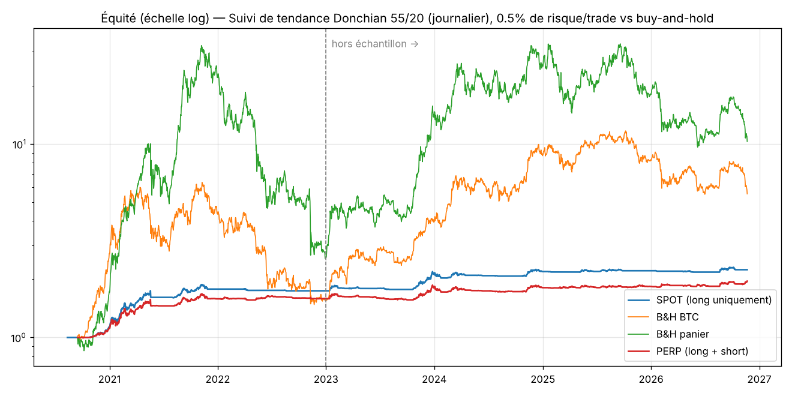

# Essai n°2 — Suivi de tendance Donchian 55/20 (journalier)

_Généré le 2026-11-21 23:10 UTC par `uv run python scripts/backtest_donchian.py`. Aucun chiffre n'est saisi à la main._

## Règles (figées avant toute exécution)

- Entrée long : clôture journalière > plus haut des 55 jours précédents (short miroir sur perp).
- Stop initial : clôture − 2 × ATR(14).
- Sortie : stop suiveur sur le plus bas des 20 derniers jours, jamais abaissé.
- Aucun objectif fixe ni sortie temporelle (on laisse courir les gains).
- Paramètres par défaut : `DonchianParams(entry_n=55, exit_n=20, stop_atr=2.0, allow_short=False)`

## Hypothèses d'exécution

- Données : archives officielles Binance (data.binance.vision).
- Signal à la clôture, **entrée à l'ouverture suivante**. Stop/objectif touchés dans la même bougie : **stop supposé en premier**. Gap au-delà du stop : sortie à l'ouverture.
- Coûts spot : taker 0,10 %, maker 0,10 %, slippage 0,05 % (×2 sur les stops). Perp : taker 0,05 %, maker 0,02 %, même slippage, **funding réel** historique.
- Portefeuille : 0.5% du capital risqué par trade, risque ouvert total ≤ 1,5 % (BTC/ETH/SOL sont corrélés), notionnel ≤ 1× le capital (aucun levier). Équité valorisée chaque jour au prix de marché.
- Les statistiques de trades couvrent tout l'historique de chaque actif ; le portefeuille commun démarre quand les 3 actifs ont des données (SOL : août 2020 en spot, sept. 2020 en perp).
- In-sample : début → 2022-12-31. **Hors échantillon (OOS) : 2023-01-01 → fin.**
- Deux critères (concentration, coûts × 2) ont été ajoutés après la 1re exécution ; ils ne peuvent que durcir le verdict.
- Signal à la clôture journalière (00:00 UTC, soit 1h ou 2h à Paris), entrée à l'ouverture du jour suivant.

**Critères d'activation (fixés avant exécution)** : `min_oos_trades=30`, `min_oos_expectancy_r=0.1`, `min_oos_profit_factor=1.25`, `wf_expectancy_positive=1`, `max_oos_drawdown=-0.1`, `min_grid_positive_frac=0.6`, `min_oos_exp_ex_top3=0.0`, `min_oos_exp_cost_x2=0.0`

## SPOT (long uniquement)

### Statistiques de trades

| Actif | Période | Trades | Win rate | Espérance nette R [IC 95 %] | Espérance brute R | Profit factor | Total R | Durée moy. (jours) |
|---|---|---|---|---|---|---|---|---|
| BTCUSDT | IS | 10 | 60% | +6.908 [-0.51 ; +19.41] | +6.960 | 17.78 | +69.1 | 47 |
| BTCUSDT | OOS | 14 | 43% | +1.051 [-0.04 ; +2.24] | +1.104 | 3.86 | +14.7 | 34 |
| ETHUSDT | IS | 12 | 50% | +2.519 [-0.19 ; +6.84] | +2.553 | 6.86 | +30.2 | 33 |
| ETHUSDT | OOS | 12 | 67% | +1.006 [+0.05 ; +2.05] | +1.047 | 4.12 | +12.1 | 37 |
| SOLUSDT | IS | 3 | 67% | +20.733 [-1.02 ; +42.61] | +20.793 | 61.99 | +62.2 | 80 |
| SOLUSDT | OOS | 13 | 38% | +2.009 [-0.46 ; +5.96] | +2.043 | 4.68 | +26.1 | 28 |
| **Total** | IS | 25 | 56% | +6.460 [+1.49 ; +12.39] | +6.504 | 16.68 | +161.5 | 44 |
| **Total** | OOS | 39 | 49% | +1.356 [+0.31 ; +2.82] | +1.400 | 4.29 | +52.9 | 33 |

### Portefeuille vs buy-and-hold

| Série | CAGR | Volatilité | Sharpe | Sortino | Max drawdown | CAGR/MaxDD | Exposition |
|---|---|---|---|---|---|---|---|
| Stratégie IS | +26.2% | 13.7% | 1.76 | 2.67 | -8.0% | 3.25 | 40% |
| B&H BTC IS | +16.9% | 70.7% | 0.57 | 0.83 | -76.6% | 0.22 | 100% |
| B&H panier égal IS | +47.8% | 102.3% | 0.90 | 1.29 | -92.1% | 0.52 | 100% |
| Stratégie OOS | +6.7% | 7.4% | 0.91 | 1.41 | -7.4% | 0.91 | 43% |
| B&H BTC OOS | +38.5% | 46.3% | 0.93 | 1.44 | -53.0% | 0.73 | 100% |
| B&H panier égal OOS | +42.2% | 66.4% | 0.86 | 1.32 | -68.6% | 0.62 | 100% |
| Stratégie Total | +13.7% | 10.3% | 1.30 | 1.99 | -8.0% | 1.70 | 42% |
| B&H BTC Total | +29.9% | 56.8% | 0.74 | 1.11 | -76.6% | 0.39 | 100% |
| B&H panier égal Total | +44.6% | 83.8% | 0.86 | 1.27 | -92.1% | 0.48 | 100% |

_Comparer le CAGR brut est trompeur : la stratégie ne risque que 0.5% par trade et n'est investie qu'une partie du temps. La comparaison pertinente est le couple Sharpe / max drawdown (rendement par unité de risque)._

### Walk-forward (entraînement 24 mois → test 6 mois, glissant)

Grille : `{'entry_n': [20, 55, 100], 'exit_n': [10, 20, 40], 'stop_atr': [1.5, 2.0, 3.0]}` → 27 combinaisons. Critère de choix : espérance R maximale sur la fenêtre d'entraînement (≥ 10 trades).

| Test | Combinaison choisie | Esp. entraînement | Trades test | Esp. test |
|---|---|---|---|---|
| 2022-08-01 → 2023-01-28 | entry_n=20, exit_n=20, stop_atr=1.5 | +17.538 | 11 | +0.847 |
| 2023-01-28 → 2023-07-27 | entry_n=55, exit_n=40, stop_atr=1.5 | +2.035 | 5 | -0.682 |
| 2023-07-27 → 2024-01-23 | entry_n=55, exit_n=20, stop_atr=1.5 | +1.723 | 4 | +9.832 |
| 2024-01-23 → 2024-07-21 | entry_n=55, exit_n=10, stop_atr=1.5 | +2.630 | 5 | +2.238 |
| 2024-07-21 → 2025-01-17 | entry_n=55, exit_n=40, stop_atr=1.5 | +6.110 | 5 | +1.283 |
| 2025-01-17 → 2025-07-16 | entry_n=55, exit_n=40, stop_atr=1.5 | +5.740 | 6 | +0.625 |
| 2025-07-16 → 2026-01-12 | entry_n=55, exit_n=40, stop_atr=1.5 | +6.351 | 2 | -1.035 |
| 2026-01-12 → 2026-07-11 | entry_n=55, exit_n=20, stop_atr=1.5 | +1.156 | 4 | -0.875 |
| 2026-07-11 → 2026-11-20 | entry_n=55, exit_n=20, stop_atr=1.5 | +0.583 | 4 | +2.025 |

| Version | Trades | Win rate | Espérance nette R [IC 95 %] | Espérance brute R | Profit factor | Total R | Durée moy. (jours) |
|---|---|---|---|---|---|---|---|
| Walk-forward (paramètres choisis sans voir l'avenir) | 46 | 39% | +1.503 [+0.25 ; +3.22] | +1.557 | 3.59 | +69.1 | 29 |
| Paramètres par défaut, mêmes périodes | 40 | 48% | +1.297 [+0.26 ; +2.72] | +1.340 | 4.03 | +51.9 | 33 |

**Sensibilité (OOS, 27 combinaisons)** : espérance min +0.531 R, médiane +1.160 R, max +2.989 R ; **100% des combinaisons positives**.
_Lecture : si seule une petite « île » de paramètres est positive, c'est du surapprentissage ; un avantage réel résiste à des variations raisonnables._

### Comportement pendant les krachs

| Épisode | Trades ouverts | R net de ces trades | Variation équité stratégie | BTC sur la période |
|---|---|---|---|---|
| Krach COVID (2020-03-08) | 0 | +0.00 | n/d (avant le portefeuille commun) | -30.7% |
| Krach mai 2021 (2021-05-10) | 2 | +44.70 | -4.25% | -40.5% |
| Effondrement LUNA (2022-05-05) | 0 | +0.00 | +0.00% | -24.2% |
| Faillite FTX (2022-11-06) | 0 | +0.00 | +0.00% | -19.9% |
| Krach août 2024 (2024-08-01) | 1 | -1.03 | -0.19% | -13.3% |
| Liquidations oct. 2025 (2025-10-09) | 0 | +0.00 | +0.00% | -6.8% |

### Robustesse

- **Concentration (OOS)** : espérance sans les 3 meilleurs trades +0.526 R, sans les 5 meilleurs +0.318 R ; trade médian -0.113 R.
- **Coûts × 2** (frais et slippage) : espérance OOS +1.298 R, profit factor 4.00.
- **Coûts × 3** (frais et slippage) : espérance OOS +1.241 R, profit factor 3.74.
- **Par année d'entrée** : 2019 : +17.8 R (4) · 2020 : +82.2 R (9) · 2021 : +65.5 R (8) · 2022 : -4.1 R (4) · 2023 : +33.6 R (12) · 2024 : +14.7 R (10) · 2025 : +2.0 R (9) · 2026 : +2.6 R (8)

### Verdict SPOT (long uniquement)

- ✅ ≥ 30 trades OOS
- ✅ espérance OOS ≥ 0.1 R
- ✅ profit factor OOS ≥ 1.25
- ✅ espérance walk-forward > 0
- ✅ max drawdown OOS > -10%
- ✅ espérance OOS sans les 3 meilleurs trades ≥ 0.0 R
- ✅ espérance OOS avec coûts × 2 ≥ 0.0 R
- ✅ ≥ 60% des combinaisons positives en OOS

**→ ACTIVABLE** (IC 95 % de l'espérance OOS : [+0.312 ; +2.816] R)

## PERP (long + short)

### Statistiques de trades

| Actif | Période | Trades | Win rate | Espérance nette R [IC 95 %] | Espérance brute R | Profit factor | Total R | Durée moy. (jours) |
|---|---|---|---|---|---|---|---|---|
| BTCUSDT | IS | 15 | 40% | +2.361 [-0.62 ; +7.88] | +3.345 | 5.32 | +35.4 | 30 |
| BTCUSDT | OOS | 24 | 46% | +0.501 [-0.14 ; +1.21] | +0.643 | 2.21 | +12.0 | 30 |
| ETHUSDT | IS | 13 | 38% | +1.503 [-0.43 ; +4.34] | +2.179 | 4.24 | +19.5 | 35 |
| ETHUSDT | OOS | 21 | 67% | +0.696 [+0.11 ; +1.32] | +0.820 | 3.48 | +14.6 | 37 |
| SOLUSDT | IS | 8 | 62% | +6.910 [-0.13 ; +15.90] | +7.820 | 20.25 | +55.3 | 58 |
| SOLUSDT | OOS | 24 | 29% | +0.708 [-0.48 ; +2.57] | +0.822 | 2.24 | +17.0 | 24 |
| **Total** | IS | 36 | 44% | +3.062 [+0.45 ; +6.48] | +3.918 | 7.44 | +110.2 | 38 |
| **Total** | OOS | 69 | 46% | +0.632 [+0.09 ; +1.35] | +0.759 | 2.47 | +43.6 | 30 |
| Total OOS | LONG | 40 | 45% | +0.950 [+0.10 ; +2.11] | +1.162 | 3.17 | +38.0 | 32 |
| Total OOS | SHORT | 29 | 48% | +0.194 [-0.24 ; +0.67] | +0.204 | 1.46 | +5.6 | 27 |

Funding cumulé sur tous les trades : **-37.12 R**.

### Portefeuille vs buy-and-hold

| Série | CAGR | Volatilité | Sharpe | Sortino | Max drawdown | CAGR/MaxDD | Exposition |
|---|---|---|---|---|---|---|---|
| Stratégie IS | +22.4% | 14.2% | 1.49 | 2.22 | -8.4% | 2.67 | 77% |
| B&H BTC IS | +21.1% | 71.5% | 0.62 | 0.91 | -76.7% | 0.27 | 100% |
| B&H panier égal IS | +51.4% | 103.3% | 0.93 | 1.33 | -92.1% | 0.56 | 100% |
| Stratégie OOS | +5.5% | 7.7% | 0.74 | 1.12 | -7.9% | 0.71 | 70% |
| B&H BTC OOS | +38.5% | 46.4% | 0.93 | 1.44 | -53.0% | 0.73 | 100% |
| B&H panier égal OOS | +42.2% | 66.5% | 0.86 | 1.32 | -68.6% | 0.62 | 100% |
| Stratégie Total | +11.4% | 10.6% | 1.08 | 1.61 | -8.4% | 1.36 | 73% |
| B&H BTC Total | +31.8% | 57.0% | 0.77 | 1.15 | -76.7% | 0.42 | 100% |
| B&H panier égal Total | +45.8% | 83.9% | 0.87 | 1.28 | -92.1% | 0.50 | 100% |

_Comparer le CAGR brut est trompeur : la stratégie ne risque que 0.5% par trade et n'est investie qu'une partie du temps. La comparaison pertinente est le couple Sharpe / max drawdown (rendement par unité de risque)._

### Walk-forward (entraînement 24 mois → test 6 mois, glissant)

Grille : `{'entry_n': [20, 55, 100], 'exit_n': [10, 20, 40], 'stop_atr': [1.5, 2.0, 3.0]}` → 27 combinaisons. Critère de choix : espérance R maximale sur la fenêtre d'entraînement (≥ 10 trades).

| Test | Combinaison choisie | Esp. entraînement | Trades test | Esp. test |
|---|---|---|---|---|
| 2022-09-04 → 2023-03-03 | entry_n=100, exit_n=40, stop_atr=1.5 | +16.452 | 5 | -0.749 |
| 2023-03-03 → 2023-08-30 | entry_n=55, exit_n=20, stop_atr=1.5 | +0.948 | 12 | -0.693 |
| 2023-08-30 → 2024-02-26 | entry_n=100, exit_n=10, stop_atr=1.5 | +0.285 | 8 | +4.412 |
| 2024-02-26 → 2024-08-24 | entry_n=100, exit_n=10, stop_atr=1.5 | +1.796 | 2 | +0.578 |
| 2024-08-24 → 2025-02-20 | entry_n=100, exit_n=40, stop_atr=1.5 | +3.534 | 5 | -0.133 |
| 2025-02-20 → 2025-08-19 | entry_n=100, exit_n=40, stop_atr=1.5 | +3.492 | 11 | -0.435 |
| 2025-08-19 → 2026-02-15 | entry_n=55, exit_n=40, stop_atr=1.5 | +2.206 | 10 | -0.051 |
| 2026-02-15 → 2026-08-14 | entry_n=55, exit_n=20, stop_atr=2.0 | +0.244 | 6 | -0.304 |
| 2026-08-14 → 2026-11-20 | entry_n=55, exit_n=20, stop_atr=2.0 | +0.422 | 8 | +1.549 |

| Version | Trades | Win rate | Espérance nette R [IC 95 %] | Espérance brute R | Profit factor | Total R | Durée moy. (jours) |
|---|---|---|---|---|---|---|---|
| Walk-forward (paramètres choisis sans voir l'avenir) | 67 | 33% | +0.433 [-0.21 ; +1.29] | +0.582 | 1.73 | +29.0 | 26 |
| Paramètres par défaut, mêmes périodes | 74 | 45% | +0.552 [+0.04 ; +1.19] | +0.683 | 2.24 | +40.9 | 29 |

**Sensibilité (OOS, 27 combinaisons)** : espérance min +0.203 R, médiane +0.556 R, max +1.020 R ; **100% des combinaisons positives**.
_Lecture : si seule une petite « île » de paramètres est positive, c'est du surapprentissage ; un avantage réel résiste à des variations raisonnables._

### Comportement pendant les krachs

| Épisode | Trades ouverts | R net de ces trades | Variation équité stratégie | BTC sur la période |
|---|---|---|---|---|
| Krach COVID (2020-03-08) | 2 | +0.17 | n/d (avant le portefeuille commun) | -30.8% |
| Krach mai 2021 (2021-05-10) | 3 | +36.62 | -4.19% | -40.6% |
| Effondrement LUNA (2022-05-05) | 3 | +6.27 | +1.34% | -24.2% |
| Faillite FTX (2022-11-06) | 3 | -1.50 | -0.64% | -19.9% |
| Krach août 2024 (2024-08-01) | 2 | -0.67 | +0.32% | -13.3% |
| Liquidations oct. 2025 (2025-10-09) | 1 | +1.19 | -0.42% | -6.8% |

### Robustesse

- **Concentration (OOS)** : espérance sans les 3 meilleurs trades +0.240 R, sans les 5 meilleurs +0.140 R ; trade médian -0.217 R.
- **Coûts × 2** (frais et slippage) : espérance OOS +0.598 R, profit factor 2.36.
- **Coûts × 3** (frais et slippage) : espérance OOS +0.564 R, profit factor 2.24.
- **Par année d'entrée** : 2020 : +55.8 R (10) · 2021 : +54.1 R (9) · 2022 : +0.3 R (17) · 2023 : +19.4 R (19) · 2024 : +8.4 R (14) · 2025 : +2.3 R (18) · 2026 : +13.5 R (18)

### Verdict PERP (long + short)

- ✅ ≥ 30 trades OOS
- ✅ espérance OOS ≥ 0.1 R
- ✅ profit factor OOS ≥ 1.25
- ✅ espérance walk-forward > 0
- ✅ max drawdown OOS > -10%
- ✅ espérance OOS sans les 3 meilleurs trades ≥ 0.0 R
- ✅ espérance OOS avec coûts × 2 ≥ 0.0 R
- ✅ ≥ 60% des combinaisons positives en OOS

**→ ACTIVABLE** (IC 95 % de l'espérance OOS : [+0.091 ; +1.347] R)

## Biais de survie : actifs morts (spot, long uniquement)

| Actif | Période testée | Trades | Win rate | Espérance nette R [IC 95 %] | Espérance brute R | Profit factor | Total R | Durée moy. (jours) |
|---|---|---|---|---|---|---|---|---|
| LUNAUSDT | 2020-08-21 → 2022-05-12 | 5 | 60% | +44.704 [-0.32 ; +128.49] | +44.813 | 187.54 | +223.5 | 64 |
| FTTUSDT | 2019-12-20 → 2022-11-14 | 10 | 20% | +9.198 [-1.02 ; +29.00] | +9.246 | 12.77 | +92.0 | 29 |

_Temps de calcul : 13 s._