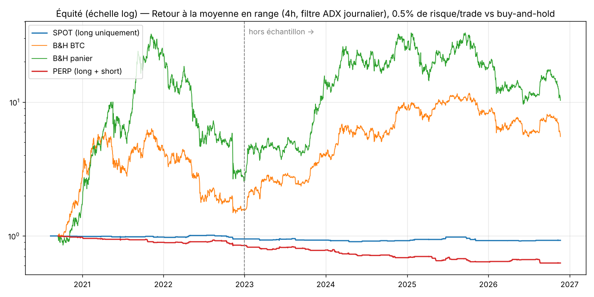

# Essai n°3 — Retour à la moyenne en range (4h, filtre ADX journalier)

_Généré le 2026-11-22 13:15 UTC par `uv run python scripts/backtest_trials_phase5.py`. Aucun chiffre n'est saisi à la main._

## Règles (figées avant toute exécution)

- Régime : ADX journalier < 20 (range).
- Entrée long : clôture 4h < bande de Bollinger basse (20, 2) et RSI(14) < 30 (short miroir sur perp).
- Stop : clôture − 1,5 ATR ; objectif : moyenne de Bollinger, 100 % ; objectif ≥ 0,5 R.
- Sortie temporelle : 12 bougies 4h.
- Paramètres par défaut : `MeanReversionParams(adx_max=20.0, rsi_max=30.0, stop_atr=1.5, time_stop_bars=12, min_target_r=0.5, allow_short=False)`

## Hypothèses d'exécution

- Données : archives officielles Binance (data.binance.vision).
- Signal à la clôture, **entrée à l'ouverture suivante**. Stop/objectif touchés dans la même bougie : **stop supposé en premier**. Gap au-delà du stop : sortie à l'ouverture.
- Coûts spot : taker 0,10 %, maker 0,10 %, slippage 0,05 % (×2 sur les stops). Perp : taker 0,05 %, maker 0,02 %, même slippage, **funding réel** historique.
- Portefeuille : 0.5% du capital risqué par trade, risque ouvert total ≤ 1,5 % (BTC/ETH/SOL sont corrélés), notionnel ≤ 1× le capital (aucun levier). Équité valorisée chaque jour au prix de marché.
- Les statistiques de trades couvrent tout l'historique de chaque actif ; le portefeuille commun démarre quand les 3 actifs ont des données (SOL : août 2020 en spot, sept. 2020 en perp).
- In-sample : début → 2022-12-31. **Hors échantillon (OOS) : 2023-01-01 → fin.**

**Critères d'activation (fixés avant exécution)** : `min_oos_trades=30`, `min_oos_expectancy_r=0.15`, `min_oos_profit_factor=1.3`, `wf_expectancy_positive=1`, `max_oos_drawdown=-0.1`, `min_grid_positive_frac=0.6`, `min_oos_exp_ex_top3=0.0`, `min_oos_exp_cost_x2=0.0`

## SPOT (long uniquement)

### Statistiques de trades

| Actif | Période | Trades | Win rate | Espérance nette R [IC 95 %] | Espérance brute R | Profit factor | Total R | Durée moy. (bougies 4h) |
|---|---|---|---|---|---|---|---|---|
| BTCUSDT | IS | 20 | 35% | -0.191 [-0.63 ; +0.30] | -0.082 | 0.67 | -3.8 | 6 |
| BTCUSDT | OOS | 27 | 37% | +0.044 [-0.42 ; +0.54] | +0.184 | 1.08 | +1.2 | 7 |
| ETHUSDT | IS | 25 | 32% | -0.170 [-0.58 ; +0.28] | -0.099 | 0.72 | -4.3 | 6 |
| ETHUSDT | OOS | 29 | 38% | -0.188 [-0.60 ; +0.27] | -0.082 | 0.70 | -5.5 | 6 |
| SOLUSDT | IS | 31 | 35% | -0.139 [-0.57 ; +0.31] | -0.089 | 0.78 | -4.3 | 6 |
| SOLUSDT | OOS | 24 | 50% | -0.001 [-0.45 ; +0.45] | +0.060 | 1.00 | -0.0 | 7 |
| **Total** | IS | 76 | 34% | -0.163 [-0.42 ; +0.11] | -0.090 | 0.74 | -12.4 | 6 |
| **Total** | OOS | 80 | 41% | -0.054 [-0.31 ; +0.22] | +0.050 | 0.90 | -4.3 | 7 |

### Portefeuille vs buy-and-hold

| Série | CAGR | Volatilité | Sharpe | Sortino | Max drawdown | CAGR/MaxDD | Exposition |
|---|---|---|---|---|---|---|---|
| Stratégie IS | -2.1% | 3.4% | -0.61 | -0.75 | -6.4% | -0.33 | 4% |
| B&H BTC IS | +16.9% | 70.7% | 0.57 | 0.83 | -76.6% | 0.22 | 100% |
| B&H panier égal IS | +47.8% | 102.3% | 0.90 | 1.29 | -92.1% | 0.52 | 100% |
| Stratégie OOS | -0.6% | 3.5% | -0.16 | -0.22 | -6.5% | -0.09 | 3% |
| B&H BTC OOS | +38.5% | 46.3% | 0.93 | 1.44 | -53.0% | 0.73 | 100% |
| B&H panier égal OOS | +42.2% | 66.4% | 0.86 | 1.32 | -68.6% | 0.62 | 100% |
| Stratégie Total | -1.2% | 3.5% | -0.33 | -0.43 | -10.5% | -0.11 | 4% |
| B&H BTC Total | +29.9% | 56.8% | 0.74 | 1.11 | -76.6% | 0.39 | 100% |
| B&H panier égal Total | +44.6% | 83.8% | 0.86 | 1.27 | -92.1% | 0.48 | 100% |

_Comparer le CAGR brut est trompeur : la stratégie ne risque que 0.5% par trade et n'est investie qu'une partie du temps. La comparaison pertinente est le couple Sharpe / max drawdown (rendement par unité de risque)._

### Walk-forward (entraînement 24 mois → test 6 mois, glissant)

Grille : `{'rsi_max': [25.0, 30.0, 35.0], 'stop_atr': [1.0, 1.5, 2.0], 'time_stop_bars': [6, 12, 24]}` → 27 combinaisons. Critère de choix : espérance R maximale sur la fenêtre d'entraînement (≥ 15 trades).

| Test | Combinaison choisie | Esp. entraînement | Trades test | Esp. test |
|---|---|---|---|---|
| 2022-08-01 → 2023-01-28 | rsi_max=30.0, stop_atr=1.0, time_stop_bars=6 | +0.273 | 22 | -0.775 |
| 2023-01-28 → 2023-07-27 | rsi_max=25.0, stop_atr=1.5, time_stop_bars=6 | -0.017 | 13 | +0.174 |
| 2023-07-27 → 2024-01-23 | rsi_max=25.0, stop_atr=1.5, time_stop_bars=6 | -0.032 | 7 | -0.768 |
| 2024-01-23 → 2024-07-21 | rsi_max=25.0, stop_atr=1.5, time_stop_bars=6 | -0.147 | 6 | +0.265 |
| 2024-07-21 → 2025-01-17 | rsi_max=25.0, stop_atr=1.5, time_stop_bars=6 | -0.151 | 1 | +0.481 |
| 2025-01-17 → 2025-07-16 | rsi_max=25.0, stop_atr=1.0, time_stop_bars=6 | -0.025 | 6 | +1.160 |
| 2025-07-16 → 2026-01-12 | rsi_max=30.0, stop_atr=1.5, time_stop_bars=24 | +0.377 | 17 | -0.768 |
| 2026-01-12 → 2026-07-11 | rsi_max=25.0, stop_atr=1.5, time_stop_bars=24 | +0.256 | 1 | +0.299 |
| 2026-07-11 → 2026-11-20 | rsi_max=25.0, stop_atr=1.5, time_stop_bars=24 | +0.252 | 0 | +0.000 |

| Version | Trades | Win rate | Espérance nette R [IC 95 %] | Espérance brute R | Profit factor | Total R | Durée moy. (bougies 4h) |
|---|---|---|---|---|---|---|---|
| Walk-forward (paramètres choisis sans voir l'avenir) | 73 | 33% | -0.327 [-0.60 ; -0.03] | -0.217 | 0.56 | -23.9 | 5 |
| Paramètres par défaut, mêmes périodes | 99 | 36% | -0.172 [-0.40 ; +0.07] | -0.072 | 0.72 | -17.0 | 6 |

**Sensibilité (OOS, 27 combinaisons)** : espérance min -0.285 R, médiane -0.057 R, max +0.030 R ; **7% des combinaisons positives**.
_Lecture : si seule une petite « île » de paramètres est positive, c'est du surapprentissage ; un avantage réel résiste à des variations raisonnables._

### Comportement pendant les krachs

| Épisode | Trades ouverts | R net de ces trades | Variation équité stratégie | BTC sur la période |
|---|---|---|---|---|
| Krach COVID (2020-03-08) | 0 | +0.00 | n/d (avant le portefeuille commun) | -30.7% |
| Krach mai 2021 (2021-05-10) | 2 | -2.10 | -1.05% | -40.5% |
| Effondrement LUNA (2022-05-05) | 0 | +0.00 | +0.00% | -24.2% |
| Faillite FTX (2022-11-06) | 7 | -5.85 | -2.90% | -19.9% |
| Krach août 2024 (2024-08-01) | 0 | +0.00 | +0.00% | -13.3% |
| Liquidations oct. 2025 (2025-10-09) | 4 | -4.27 | -2.12% | -6.8% |

### Robustesse

- **Concentration (OOS)** : espérance sans les 3 meilleurs trades -0.160 R, sans les 5 meilleurs -0.228 R ; trade médian -0.508 R.
- **Coûts × 2** (frais et slippage) : espérance OOS -0.162 R, profit factor 0.74.
- **Coûts × 3** (frais et slippage) : espérance OOS -0.266 R, profit factor 0.62.
- **Par année d'entrée** : 2019 : -6.7 R (13) · 2020 : +2.8 R (17) · 2021 : -2.2 R (17) · 2022 : -6.3 R (29) · 2023 : -3.9 R (26) · 2024 : -1.8 R (17) · 2025 : +0.5 R (30) · 2026 : +0.9 R (7)

### Verdict SPOT (long uniquement)

- ✅ ≥ 30 trades OOS
- ❌ espérance OOS ≥ 0.15 R
- ❌ profit factor OOS ≥ 1.3
- ❌ espérance walk-forward > 0
- ✅ max drawdown OOS > -10%
- ❌ espérance OOS sans les 3 meilleurs trades ≥ 0.0 R
- ❌ espérance OOS avec coûts × 2 ≥ 0.0 R
- ❌ ≥ 60% des combinaisons positives en OOS

**→ NON ACTIVÉE** (IC 95 % de l'espérance OOS : [-0.312 ; +0.219] R)

## PERP (long + short)

### Statistiques de trades

| Actif | Période | Trades | Win rate | Espérance nette R [IC 95 %] | Espérance brute R | Profit factor | Total R | Durée moy. (bougies 4h) |
|---|---|---|---|---|---|---|---|---|
| BTCUSDT | IS | 41 | 29% | -0.385 [-0.66 ; -0.09] | -0.318 | 0.40 | -15.8 | 6 |
| BTCUSDT | OOS | 81 | 30% | -0.333 [-0.57 ; -0.07] | -0.234 | 0.54 | -27.0 | 6 |
| ETHUSDT | IS | 50 | 30% | -0.360 [-0.64 ; -0.05] | -0.322 | 0.48 | -18.0 | 6 |
| ETHUSDT | OOS | 73 | 37% | -0.221 [-0.49 ; +0.06] | -0.161 | 0.66 | -16.1 | 6 |
| SOLUSDT | IS | 53 | 28% | -0.329 [-0.63 ; +0.01] | -0.313 | 0.55 | -17.4 | 5 |
| SOLUSDT | OOS | 67 | 39% | -0.240 [-0.49 ; +0.02] | -0.193 | 0.63 | -16.1 | 6 |
| **Total** | IS | 144 | 29% | -0.355 [-0.52 ; -0.18] | -0.317 | 0.49 | -51.2 | 6 |
| **Total** | OOS | 221 | 35% | -0.268 [-0.41 ; -0.11] | -0.197 | 0.60 | -59.2 | 6 |
| Total OOS | LONG | 74 | 46% | +0.010 [-0.26 ; +0.30] | +0.077 | 1.02 | +0.8 | 7 |
| Total OOS | SHORT | 147 | 29% | -0.408 [-0.58 ; -0.23] | -0.335 | 0.46 | -60.0 | 6 |

Funding cumulé sur tous les trades : **+3.36 R**.

### Portefeuille vs buy-and-hold

| Série | CAGR | Volatilité | Sharpe | Sortino | Max drawdown | CAGR/MaxDD | Exposition |
|---|---|---|---|---|---|---|---|
| Stratégie IS | -6.9% | 5.0% | -1.40 | -1.65 | -15.3% | -0.45 | 10% |
| B&H BTC IS | +21.1% | 71.5% | 0.62 | 0.91 | -76.7% | 0.27 | 100% |
| B&H panier égal IS | +51.4% | 103.3% | 0.93 | 1.33 | -92.1% | 0.56 | 100% |
| Stratégie OOS | -7.5% | 5.6% | -1.37 | -1.69 | -26.1% | -0.29 | 10% |
| B&H BTC OOS | +38.5% | 46.4% | 0.93 | 1.44 | -53.0% | 0.73 | 100% |
| B&H panier égal OOS | +42.2% | 66.5% | 0.86 | 1.32 | -68.6% | 0.62 | 100% |
| Stratégie Total | -7.2% | 5.4% | -1.38 | -1.67 | -37.3% | -0.19 | 10% |
| B&H BTC Total | +31.8% | 57.0% | 0.77 | 1.15 | -76.7% | 0.42 | 100% |
| B&H panier égal Total | +45.8% | 83.9% | 0.87 | 1.28 | -92.1% | 0.50 | 100% |

_Comparer le CAGR brut est trompeur : la stratégie ne risque que 0.5% par trade et n'est investie qu'une partie du temps. La comparaison pertinente est le couple Sharpe / max drawdown (rendement par unité de risque)._

### Walk-forward (entraînement 24 mois → test 6 mois, glissant)

Grille : `{'rsi_max': [25.0, 30.0, 35.0], 'stop_atr': [1.0, 1.5, 2.0], 'time_stop_bars': [6, 12, 24]}` → 27 combinaisons. Critère de choix : espérance R maximale sur la fenêtre d'entraînement (≥ 15 trades).

| Test | Combinaison choisie | Esp. entraînement | Trades test | Esp. test |
|---|---|---|---|---|
| 2022-09-04 → 2023-03-03 | rsi_max=25.0, stop_atr=2.0, time_stop_bars=6 | +0.006 | 22 | -0.506 |
| 2023-03-03 → 2023-08-30 | rsi_max=30.0, stop_atr=2.0, time_stop_bars=24 | -0.156 | 38 | -0.044 |
| 2023-08-30 → 2024-02-26 | rsi_max=30.0, stop_atr=2.0, time_stop_bars=24 | -0.120 | 36 | -0.338 |
| 2024-02-26 → 2024-08-24 | rsi_max=30.0, stop_atr=2.0, time_stop_bars=24 | -0.168 | 19 | -0.681 |
| 2024-08-24 → 2025-02-20 | rsi_max=25.0, stop_atr=1.5, time_stop_bars=6 | -0.233 | 14 | +0.059 |
| 2025-02-20 → 2025-08-19 | rsi_max=25.0, stop_atr=1.5, time_stop_bars=6 | -0.072 | 22 | -0.185 |
| 2025-08-19 → 2026-02-15 | rsi_max=25.0, stop_atr=1.5, time_stop_bars=6 | -0.211 | 13 | -0.120 |
| 2026-02-15 → 2026-08-14 | rsi_max=25.0, stop_atr=1.5, time_stop_bars=6 | -0.176 | 2 | +0.143 |
| 2026-08-14 → 2026-11-20 | rsi_max=30.0, stop_atr=2.0, time_stop_bars=6 | -0.081 | 10 | -0.859 |

| Version | Trades | Win rate | Espérance nette R [IC 95 %] | Espérance brute R | Profit factor | Total R | Durée moy. (bougies 4h) |
|---|---|---|---|---|---|---|---|
| Walk-forward (paramètres choisis sans voir l'avenir) | 176 | 35% | -0.290 [-0.44 ; -0.14] | -0.239 | 0.54 | -51.0 | 7 |
| Paramètres par défaut, mêmes périodes | 252 | 34% | -0.299 [-0.44 ; -0.16] | -0.234 | 0.56 | -75.4 | 6 |

**Sensibilité (OOS, 27 combinaisons)** : espérance min -0.419 R, médiane -0.292 R, max -0.199 R ; **0% des combinaisons positives**.
_Lecture : si seule une petite « île » de paramètres est positive, c'est du surapprentissage ; un avantage réel résiste à des variations raisonnables._

### Comportement pendant les krachs

| Épisode | Trades ouverts | R net de ces trades | Variation équité stratégie | BTC sur la période |
|---|---|---|---|---|
| Krach COVID (2020-03-08) | 0 | +0.00 | n/d (avant le portefeuille commun) | -30.8% |
| Krach mai 2021 (2021-05-10) | 0 | +0.00 | +0.00% | -40.6% |
| Effondrement LUNA (2022-05-05) | 0 | +0.00 | +0.00% | -24.2% |
| Faillite FTX (2022-11-06) | 11 | -3.59 | -1.70% | -19.9% |
| Krach août 2024 (2024-08-01) | 0 | +0.00 | +0.00% | -13.3% |
| Liquidations oct. 2025 (2025-10-09) | 3 | -3.15 | -1.57% | -6.8% |

### Robustesse

- **Concentration (OOS)** : espérance sans les 3 meilleurs trades -0.308 R, sans les 5 meilleurs -0.333 R ; trade médian -1.050 R.
- **Coûts × 2** (frais et slippage) : espérance OOS -0.347 R, profit factor 0.53.
- **Coûts × 3** (frais et slippage) : espérance OOS -0.422 R, profit factor 0.47.
- **Par année d'entrée** : 2020 : -23.1 R (54) · 2021 : -17.5 R (33) · 2022 : -10.6 R (57) · 2023 : -15.4 R (60) · 2024 : -25.9 R (65) · 2025 : -13.9 R (62) · 2026 : -4.0 R (34)

### Verdict PERP (long + short)

- ✅ ≥ 30 trades OOS
- ❌ espérance OOS ≥ 0.15 R
- ❌ profit factor OOS ≥ 1.3
- ❌ espérance walk-forward > 0
- ❌ max drawdown OOS > -10%
- ❌ espérance OOS sans les 3 meilleurs trades ≥ 0.0 R
- ❌ espérance OOS avec coûts × 2 ≥ 0.0 R
- ❌ ≥ 60% des combinaisons positives en OOS

**→ NON ACTIVÉE** (IC 95 % de l'espérance OOS : [-0.414 ; -0.109] R)

## Biais de survie : actifs morts (spot, long uniquement)

| Actif | Période testée | Trades | Win rate | Espérance nette R [IC 95 %] | Espérance brute R | Profit factor | Total R | Durée moy. (bougies 4h) |
|---|---|---|---|---|---|---|---|---|
| LUNAUSDT | 2020-08-21 → 2022-05-12 | 12 | 33% | -0.300 [-0.88 ; +0.33] | -0.242 | 0.58 | -3.6 | 5 |
|  ↳ dernier trade | entrée 2022-05-01, sortie 2022-05-02 (temps) | +1.47 R | | | | | |
|  ↳ dernier trade | entrée 2022-05-07, sortie 2022-05-07 (stop) | -1.05 R | | | | | |
|  ↳ dernier trade | entrée 2022-05-08, sortie 2022-05-08 (stop) | -1.04 R | | | | | |
|  ↳ dernier trade | entrée 2022-05-08, sortie 2022-05-08 (stop) | -1.04 R | | | | | |
|  ↳ dernier trade | entrée 2022-05-09, sortie 2022-05-09 (stop) | -1.02 R | | | | | |
| FTTUSDT | 2019-12-20 → 2022-11-14 | 34 | 24% | -0.422 [-0.75 ; -0.05] | -0.346 | 0.43 | -14.4 | 6 |
|  ↳ dernier trade | entrée 2022-10-20, sortie 2022-10-21 (stop) | -1.13 R | | | | | |
|  ↳ dernier trade | entrée 2022-11-06, sortie 2022-11-06 (stop) | -1.08 R | | | | | |
|  ↳ dernier trade | entrée 2022-11-06, sortie 2022-11-08 (stop) | -1.05 R | | | | | |
|  ↳ dernier trade | entrée 2022-11-08, sortie 2022-11-08 (stop) | -1.03 R | | | | | |
|  ↳ dernier trade | entrée 2022-11-08, sortie 2022-11-08 (stop) | -1.02 R | | | | | |
|  ↳ dernier trade | entrée 2022-11-08, sortie 2022-11-08 (stop) | -1.01 R | | | | | |
|  ↳ dernier trade | entrée 2022-11-08, sortie 2022-11-10 (temps) | -0.22 R | | | | | |

_Temps de calcul : 97 s._