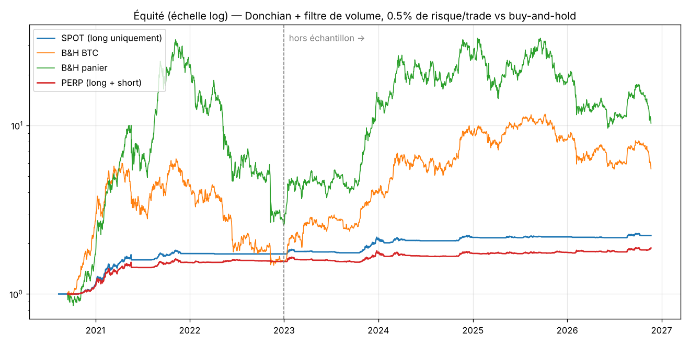

# Essai n°4 — Donchian + filtre de volume

_Généré le 2026-11-22 13:17 UTC par `uv run python scripts/backtest_trials_phase5.py`. Aucun chiffre n'est saisi à la main._

## Règles (figées avant toute exécution)

- Donchian 55/20 de l'essai n°2, inchangé.
- Filtre : volume de la bougie de cassure ≥ 1,5 × moyenne 20 j.
- Paramètres par défaut : `DonchianParams(entry_n=55, exit_n=20, stop_atr=2.0, allow_short=False, min_relvol=1.5, min_adx=0.0)`

## Hypothèses d'exécution

- Données : archives officielles Binance (data.binance.vision).
- Signal à la clôture, **entrée à l'ouverture suivante**. Stop/objectif touchés dans la même bougie : **stop supposé en premier**. Gap au-delà du stop : sortie à l'ouverture.
- Coûts spot : taker 0,10 %, maker 0,10 %, slippage 0,05 % (×2 sur les stops). Perp : taker 0,05 %, maker 0,02 %, même slippage, **funding réel** historique.
- Portefeuille : 0.5% du capital risqué par trade, risque ouvert total ≤ 1,5 % (BTC/ETH/SOL sont corrélés), notionnel ≤ 1× le capital (aucun levier). Équité valorisée chaque jour au prix de marché.
- Les statistiques de trades couvrent tout l'historique de chaque actif ; le portefeuille commun démarre quand les 3 actifs ont des données (SOL : août 2020 en spot, sept. 2020 en perp).
- In-sample : début → 2022-12-31. **Hors échantillon (OOS) : 2023-01-01 → fin.**

**Critères d'activation (fixés avant exécution)** : `min_oos_trades=30`, `min_oos_expectancy_r=0.15`, `min_oos_profit_factor=1.3`, `wf_expectancy_positive=1`, `max_oos_drawdown=-0.1`, `min_grid_positive_frac=0.6`, `min_oos_exp_ex_top3=0.0`, `min_oos_exp_cost_x2=0.0`

## SPOT (long uniquement)

### Statistiques de trades

| Actif | Période | Trades | Win rate | Espérance nette R [IC 95 %] | Espérance brute R | Profit factor | Total R | Durée moy. (jours) |
|---|---|---|---|---|---|---|---|---|
| BTCUSDT | IS | 6 | 83% | +11.997 [-0.12 ; +29.89] | +12.063 | 70.98 | +72.0 | 68 |
| BTCUSDT | OOS | 13 | 38% | +1.123 [-0.02 ; +2.43] | +1.178 | 4.34 | +14.6 | 35 |
| ETHUSDT | IS | 8 | 50% | +3.375 [-0.44 ; +9.43] | +3.412 | 8.96 | +27.0 | 34 |
| ETHUSDT | OOS | 12 | 58% | +0.915 [-0.08 ; +2.00] | +0.956 | 3.24 | +11.0 | 35 |
| SOLUSDT | IS | 3 | 67% | +19.532 [-1.02 ; +42.61] | +19.590 | 58.45 | +58.6 | 80 |
| SOLUSDT | OOS | 10 | 50% | +2.704 [-0.33 ; +7.64] | +2.737 | 7.08 | +27.0 | 31 |
| **Total** | IS | 17 | 65% | +9.269 [+2.45 ; +17.88] | +9.320 | 29.95 | +157.6 | 54 |
| **Total** | OOS | 35 | 49% | +1.503 [+0.39 ; +3.11] | +1.547 | 4.83 | +52.6 | 34 |

### Portefeuille vs buy-and-hold

| Série | CAGR | Volatilité | Sharpe | Sortino | Max drawdown | CAGR/MaxDD | Exposition |
|---|---|---|---|---|---|---|---|
| Stratégie IS | +25.8% | 13.1% | 1.81 | 2.78 | -7.8% | 3.30 | 37% |
| B&H BTC IS | +16.9% | 70.7% | 0.57 | 0.83 | -76.6% | 0.22 | 100% |
| B&H panier égal IS | +47.8% | 102.3% | 0.90 | 1.29 | -92.1% | 0.52 | 100% |
| Stratégie OOS | +6.7% | 7.3% | 0.92 | 1.44 | -7.4% | 0.90 | 40% |
| B&H BTC OOS | +38.5% | 46.3% | 0.93 | 1.44 | -53.0% | 0.73 | 100% |
| B&H panier égal OOS | +42.2% | 66.4% | 0.86 | 1.32 | -68.6% | 0.62 | 100% |
| Stratégie Total | +13.6% | 9.9% | 1.33 | 2.06 | -7.8% | 1.74 | 39% |
| B&H BTC Total | +29.9% | 56.8% | 0.74 | 1.11 | -76.6% | 0.39 | 100% |
| B&H panier égal Total | +44.6% | 83.8% | 0.86 | 1.27 | -92.1% | 0.48 | 100% |

_Comparer le CAGR brut est trompeur : la stratégie ne risque que 0.5% par trade et n'est investie qu'une partie du temps. La comparaison pertinente est le couple Sharpe / max drawdown (rendement par unité de risque)._

### Walk-forward (entraînement 24 mois → test 6 mois, glissant)

Grille : `{'entry_n': [20, 55, 100], 'exit_n': [10, 20, 40], 'stop_atr': [1.5, 2.0, 3.0]}` → 27 combinaisons. Critère de choix : espérance R maximale sur la fenêtre d'entraînement (≥ 8 trades).

| Test | Combinaison choisie | Esp. entraînement | Trades test | Esp. test |
|---|---|---|---|---|
| 2022-08-01 → 2023-01-28 | entry_n=20, exit_n=20, stop_atr=1.5 | +19.852 | 9 | +1.031 |
| 2023-01-28 → 2023-07-27 | entry_n=55, exit_n=10, stop_atr=1.5 | +2.200 | 5 | -0.572 |
| 2023-07-27 → 2024-01-23 | entry_n=55, exit_n=20, stop_atr=1.5 | +2.357 | 4 | +9.832 |
| 2024-01-23 → 2024-07-21 | entry_n=55, exit_n=10, stop_atr=1.5 | +3.476 | 5 | +2.238 |
| 2024-07-21 → 2025-01-17 | entry_n=55, exit_n=40, stop_atr=1.5 | +6.598 | 3 | +2.830 |
| 2025-01-17 → 2025-07-16 | entry_n=55, exit_n=40, stop_atr=1.5 | +6.721 | 6 | +0.370 |
| 2025-07-16 → 2026-01-12 | entry_n=55, exit_n=40, stop_atr=1.5 | +7.455 | 1 | -1.041 |
| 2026-01-12 → 2026-07-11 | entry_n=55, exit_n=20, stop_atr=1.5 | +1.455 | 3 | -0.814 |
| 2026-07-11 → 2026-11-20 | entry_n=55, exit_n=20, stop_atr=1.5 | +0.919 | 4 | +2.025 |

| Version | Trades | Win rate | Espérance nette R [IC 95 %] | Espérance brute R | Profit factor | Total R | Durée moy. (jours) |
|---|---|---|---|---|---|---|---|
| Walk-forward (paramètres choisis sans voir l'avenir) | 40 | 45% | +1.807 [+0.37 ; +3.80] | +1.863 | 4.44 | +72.3 | 30 |
| Paramètres par défaut, mêmes périodes | 35 | 49% | +1.503 [+0.39 ; +3.11] | +1.547 | 4.83 | +52.6 | 34 |

**Sensibilité (OOS, 27 combinaisons)** : espérance min +0.554 R, médiane +1.337 R, max +3.464 R ; **100% des combinaisons positives**.
_Lecture : si seule une petite « île » de paramètres est positive, c'est du surapprentissage ; un avantage réel résiste à des variations raisonnables._

### Comportement pendant les krachs

| Épisode | Trades ouverts | R net de ces trades | Variation équité stratégie | BTC sur la période |
|---|---|---|---|---|
| Krach COVID (2020-03-08) | 0 | +0.00 | n/d (avant le portefeuille commun) | -30.7% |
| Krach mai 2021 (2021-05-10) | 1 | +42.61 | -2.66% | -40.5% |
| Effondrement LUNA (2022-05-05) | 0 | +0.00 | +0.00% | -24.2% |
| Faillite FTX (2022-11-06) | 0 | +0.00 | +0.00% | -19.9% |
| Krach août 2024 (2024-08-01) | 0 | +0.00 | +0.00% | -13.3% |
| Liquidations oct. 2025 (2025-10-09) | 0 | +0.00 | +0.00% | -6.8% |

### Robustesse

- **Concentration (OOS)** : espérance sans les 3 meilleurs trades +0.583 R, sans les 5 meilleurs +0.351 R ; trade médian -0.113 R.
- **Coûts × 2** (frais et slippage) : espérance OOS +1.443 R, profit factor 4.49.
- **Coûts × 3** (frais et slippage) : espérance OOS +1.383 R, profit factor 4.19.
- **Par année d'entrée** : 2019 : +17.8 R (4) · 2020 : +81.2 R (7) · 2021 : +59.6 R (5) · 2022 : -1.0 R (1) · 2023 : +33.6 R (11) · 2024 : +14.0 R (9) · 2025 : +1.4 R (8) · 2026 : +3.6 R (7)

### Verdict SPOT (long uniquement)

- ✅ ≥ 30 trades OOS
- ✅ espérance OOS ≥ 0.15 R
- ✅ profit factor OOS ≥ 1.3
- ✅ espérance walk-forward > 0
- ✅ max drawdown OOS > -10%
- ✅ espérance OOS sans les 3 meilleurs trades ≥ 0.0 R
- ✅ espérance OOS avec coûts × 2 ≥ 0.0 R
- ✅ ≥ 60% des combinaisons positives en OOS

**→ ACTIVABLE** (IC 95 % de l'espérance OOS : [+0.386 ; +3.110] R)

## PERP (long + short)

### Statistiques de trades

| Actif | Période | Trades | Win rate | Espérance nette R [IC 95 %] | Espérance brute R | Profit factor | Total R | Durée moy. (jours) |
|---|---|---|---|---|---|---|---|---|
| BTCUSDT | IS | 12 | 42% | +3.031 [-0.61 ; +9.82] | +4.236 | 7.22 | +36.4 | 33 |
| BTCUSDT | OOS | 24 | 42% | +0.421 [-0.20 ; +1.13] | +0.563 | 1.98 | +10.1 | 29 |
| ETHUSDT | IS | 11 | 36% | +1.615 [-0.62 ; +5.05] | +2.345 | 3.88 | +17.8 | 34 |
| ETHUSDT | OOS | 20 | 65% | +0.546 [-0.06 ; +1.21] | +0.650 | 2.52 | +10.9 | 32 |
| SOLUSDT | IS | 6 | 83% | +8.765 [+0.32 ; +20.22] | +9.935 | 50.38 | +52.6 | 74 |
| SOLUSDT | OOS | 20 | 30% | +0.851 [-0.52 ; +3.02] | +0.971 | 2.51 | +17.0 | 23 |
| **Total** | IS | 29 | 48% | +3.680 [+0.47 ; +7.79] | +4.698 | 9.16 | +106.7 | 42 |
| **Total** | OOS | 64 | 45% | +0.595 [+0.04 ; +1.35] | +0.718 | 2.32 | +38.1 | 28 |
| Total OOS | LONG | 38 | 39% | +0.831 [-0.05 ; +2.03] | +1.032 | 2.64 | +31.6 | 29 |
| Total OOS | SHORT | 26 | 54% | +0.250 [-0.19 ; +0.72] | +0.259 | 1.68 | +6.5 | 28 |

Funding cumulé sur tous les trades : **-35.16 R**.

### Portefeuille vs buy-and-hold

| Série | CAGR | Volatilité | Sharpe | Sortino | Max drawdown | CAGR/MaxDD | Exposition |
|---|---|---|---|---|---|---|---|
| Stratégie IS | +21.5% | 13.7% | 1.49 | 2.23 | -8.4% | 2.56 | 72% |
| B&H BTC IS | +21.1% | 71.5% | 0.62 | 0.91 | -76.7% | 0.27 | 100% |
| B&H panier égal IS | +51.4% | 103.3% | 0.93 | 1.33 | -92.1% | 0.56 | 100% |
| Stratégie OOS | +4.9% | 7.2% | 0.69 | 1.05 | -7.6% | 0.64 | 67% |
| B&H BTC OOS | +38.5% | 46.4% | 0.93 | 1.44 | -53.0% | 0.73 | 100% |
| B&H panier égal OOS | +42.2% | 66.5% | 0.86 | 1.32 | -68.6% | 0.62 | 100% |
| Stratégie Total | +10.7% | 10.1% | 1.05 | 1.58 | -8.4% | 1.27 | 69% |
| B&H BTC Total | +31.8% | 57.0% | 0.77 | 1.15 | -76.7% | 0.42 | 100% |
| B&H panier égal Total | +45.8% | 83.9% | 0.87 | 1.28 | -92.1% | 0.50 | 100% |

_Comparer le CAGR brut est trompeur : la stratégie ne risque que 0.5% par trade et n'est investie qu'une partie du temps. La comparaison pertinente est le couple Sharpe / max drawdown (rendement par unité de risque)._

### Walk-forward (entraînement 24 mois → test 6 mois, glissant)

Grille : `{'entry_n': [20, 55, 100], 'exit_n': [10, 20, 40], 'stop_atr': [1.5, 2.0, 3.0]}` → 27 combinaisons. Critère de choix : espérance R maximale sur la fenêtre d'entraînement (≥ 8 trades).

| Test | Combinaison choisie | Esp. entraînement | Trades test | Esp. test |
|---|---|---|---|---|
| 2022-09-04 → 2023-03-03 | entry_n=20, exit_n=40, stop_atr=1.5 | +27.299 | 11 | +0.126 |
| 2023-03-03 → 2023-08-30 | entry_n=55, exit_n=40, stop_atr=1.5 | +1.093 | 9 | -0.931 |
| 2023-08-30 → 2024-02-26 | entry_n=55, exit_n=10, stop_atr=1.5 | +0.318 | 10 | +3.775 |
| 2024-02-26 → 2024-08-24 | entry_n=55, exit_n=10, stop_atr=1.5 | +1.299 | 6 | -0.951 |
| 2024-08-24 → 2025-02-20 | entry_n=100, exit_n=40, stop_atr=1.5 | +1.956 | 5 | -0.284 |
| 2025-02-20 → 2025-08-19 | entry_n=100, exit_n=40, stop_atr=1.5 | +1.973 | 9 | -0.302 |
| 2025-08-19 → 2026-02-15 | entry_n=55, exit_n=40, stop_atr=1.5 | +1.892 | 9 | +0.060 |
| 2026-02-15 → 2026-08-14 | entry_n=55, exit_n=20, stop_atr=3.0 | +0.259 | 5 | -0.190 |
| 2026-08-14 → 2026-11-20 | entry_n=55, exit_n=20, stop_atr=2.0 | +0.443 | 8 | +1.333 |

| Version | Trades | Win rate | Espérance nette R [IC 95 %] | Espérance brute R | Profit factor | Total R | Durée moy. (jours) |
|---|---|---|---|---|---|---|---|
| Walk-forward (paramètres choisis sans voir l'avenir) | 72 | 32% | +0.433 [-0.28 ; +1.50] | +0.578 | 1.67 | +31.2 | 26 |
| Paramètres par défaut, mêmes périodes | 69 | 43% | +0.506 [-0.02 ; +1.21] | +0.634 | 2.08 | +34.9 | 28 |

**Sensibilité (OOS, 27 combinaisons)** : espérance min +0.144 R, médiane +0.467 R, max +0.995 R ; **100% des combinaisons positives**.
_Lecture : si seule une petite « île » de paramètres est positive, c'est du surapprentissage ; un avantage réel résiste à des variations raisonnables._

### Comportement pendant les krachs

| Épisode | Trades ouverts | R net de ces trades | Variation équité stratégie | BTC sur la période |
|---|---|---|---|---|
| Krach COVID (2020-03-08) | 2 | +0.17 | n/d (avant le portefeuille commun) | -30.8% |
| Krach mai 2021 (2021-05-10) | 3 | +34.10 | -3.42% | -40.6% |
| Effondrement LUNA (2022-05-05) | 3 | +5.27 | +0.88% | -24.2% |
| Faillite FTX (2022-11-06) | 3 | -1.50 | -0.64% | -19.9% |
| Krach août 2024 (2024-08-01) | 1 | +0.37 | +0.51% | -13.3% |
| Liquidations oct. 2025 (2025-10-09) | 1 | +1.19 | -0.42% | -6.8% |

### Robustesse

- **Concentration (OOS)** : espérance sans les 3 meilleurs trades +0.169 R, sans les 5 meilleurs +0.057 R ; trade médian -0.304 R.
- **Coûts × 2** (frais et slippage) : espérance OOS +0.560 R, profit factor 2.21.
- **Coûts × 3** (frais et slippage) : espérance OOS +0.527 R, profit factor 2.11.
- **Par année d'entrée** : 2020 : +56.8 R (9) · 2021 : +47.3 R (8) · 2022 : +2.6 R (12) · 2023 : +17.1 R (18) · 2024 : +6.0 R (13) · 2025 : +2.3 R (16) · 2026 : +12.6 R (17)

### Verdict PERP (long + short)

- ✅ ≥ 30 trades OOS
- ✅ espérance OOS ≥ 0.15 R
- ✅ profit factor OOS ≥ 1.3
- ✅ espérance walk-forward > 0
- ✅ max drawdown OOS > -10%
- ✅ espérance OOS sans les 3 meilleurs trades ≥ 0.0 R
- ✅ espérance OOS avec coûts × 2 ≥ 0.0 R
- ✅ ≥ 60% des combinaisons positives en OOS

**→ ACTIVABLE** (IC 95 % de l'espérance OOS : [+0.041 ; +1.350] R)

## Biais de survie : actifs morts (spot, long uniquement)

| Actif | Période testée | Trades | Win rate | Espérance nette R [IC 95 %] | Espérance brute R | Profit factor | Total R | Durée moy. (jours) |
|---|---|---|---|---|---|---|---|---|
| LUNAUSDT | 2020-08-21 → 2022-05-12 | 5 | 60% | +43.918 [-0.32 ; +127.70] | +44.025 | 184.26 | +219.6 | 63 |
| FTTUSDT | 2019-12-20 → 2022-11-14 | 7 | 14% | +4.276 [-1.02 ; +14.62] | +4.312 | 6.71 | +29.9 | 34 |

_Temps de calcul : 15 s._
## Comparaison avec la Donchian validée (essai n°2)

| Marché | Espérance OOS (filtre / base) | Sharpe OOS | Espérance IS | Trades IS+OOS | Retenu ? |
|---|---|---|---|---|---|
| SPOT (long uniquement) | +1.503 / +1.356 R | 0.92 / 0.91 | +9.269 / +6.460 R | 52 / 64 | ✅ |
|  | ✅ espérance OOS supérieure | | | | |
|  | ✅ Sharpe OOS supérieur | | | | |
|  | ✅ espérance in-sample supérieure | | | | |
|  | ✅ ≥ 50 % des trades conservés | | | | |
| PERP (long + short) | +0.595 / +0.632 R | 0.69 / 0.74 | +3.680 / +3.062 R | 93 / 105 | ❌ |
|  | ❌ espérance OOS supérieure | | | | |
|  | ❌ Sharpe OOS supérieur | | | | |
|  | ✅ espérance in-sample supérieure | | | | |
|  | ✅ ≥ 50 % des trades conservés | | | | |