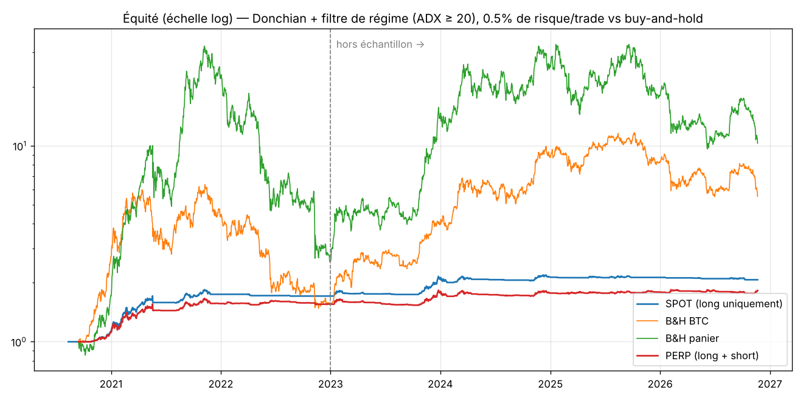

# Essai n°5 — Donchian + filtre de régime (ADX ≥ 20)

_Généré le 2026-11-22 13:17 UTC par `uv run python scripts/backtest_trials_phase5.py`. Aucun chiffre n'est saisi à la main._

## Règles (figées avant toute exécution)

- Donchian 55/20 de l'essai n°2, inchangé.
- Filtre : ADX journalier ≥ 20 au moment de la cassure (pas en range).
- Paramètres par défaut : `DonchianParams(entry_n=55, exit_n=20, stop_atr=2.0, allow_short=False, min_relvol=0.0, min_adx=20.0)`

## Hypothèses d'exécution

- Données : archives officielles Binance (data.binance.vision).
- Signal à la clôture, **entrée à l'ouverture suivante**. Stop/objectif touchés dans la même bougie : **stop supposé en premier**. Gap au-delà du stop : sortie à l'ouverture.
- Coûts spot : taker 0,10 %, maker 0,10 %, slippage 0,05 % (×2 sur les stops). Perp : taker 0,05 %, maker 0,02 %, même slippage, **funding réel** historique.
- Portefeuille : 0.5% du capital risqué par trade, risque ouvert total ≤ 1,5 % (BTC/ETH/SOL sont corrélés), notionnel ≤ 1× le capital (aucun levier). Équité valorisée chaque jour au prix de marché.
- Les statistiques de trades couvrent tout l'historique de chaque actif ; le portefeuille commun démarre quand les 3 actifs ont des données (SOL : août 2020 en spot, sept. 2020 en perp).
- In-sample : début → 2022-12-31. **Hors échantillon (OOS) : 2023-01-01 → fin.**

**Critères d'activation (fixés avant exécution)** : `min_oos_trades=30`, `min_oos_expectancy_r=0.15`, `min_oos_profit_factor=1.3`, `wf_expectancy_positive=1`, `max_oos_drawdown=-0.1`, `min_grid_positive_frac=0.6`, `min_oos_exp_ex_top3=0.0`, `min_oos_exp_cost_x2=0.0`

## SPOT (long uniquement)

### Statistiques de trades

| Actif | Période | Trades | Win rate | Espérance nette R [IC 95 %] | Espérance brute R | Profit factor | Total R | Durée moy. (jours) |
|---|---|---|---|---|---|---|---|---|
| BTCUSDT | IS | 10 | 60% | +6.582 [-0.51 ; +18.75] | +6.632 | 16.98 | +65.8 | 46 |
| BTCUSDT | OOS | 14 | 43% | +0.890 [-0.22 ; +2.16] | +0.945 | 2.95 | +12.5 | 32 |
| ETHUSDT | IS | 13 | 38% | +1.896 [-0.47 ; +5.63] | +1.928 | 4.56 | +24.6 | 27 |
| ETHUSDT | OOS | 10 | 60% | +0.974 [-0.02 ; +2.03] | +1.015 | 4.57 | +9.7 | 40 |
| SOLUSDT | IS | 3 | 67% | +20.733 [-1.02 ; +42.61] | +20.793 | 61.99 | +62.2 | 80 |
| SOLUSDT | OOS | 13 | 31% | +1.436 [-0.80 ; +5.34] | +1.466 | 3.20 | +18.7 | 23 |
| **Total** | IS | 26 | 50% | +5.872 [+1.21 ; +11.66] | +5.914 | 13.66 | +152.7 | 41 |
| **Total** | OOS | 37 | 43% | +1.104 [+0.03 ; +2.64] | +1.147 | 3.32 | +40.9 | 31 |

### Portefeuille vs buy-and-hold

| Série | CAGR | Volatilité | Sharpe | Sortino | Max drawdown | CAGR/MaxDD | Exposition |
|---|---|---|---|---|---|---|---|
| Stratégie IS | +25.2% | 13.6% | 1.73 | 2.62 | -8.0% | 3.17 | 40% |
| B&H BTC IS | +16.9% | 70.7% | 0.57 | 0.83 | -76.6% | 0.22 | 100% |
| B&H panier égal IS | +47.8% | 102.3% | 0.90 | 1.29 | -92.1% | 0.52 | 100% |
| Stratégie OOS | +5.1% | 6.9% | 0.75 | 1.16 | -6.9% | 0.73 | 42% |
| B&H BTC OOS | +38.5% | 46.3% | 0.93 | 1.44 | -53.0% | 0.73 | 100% |
| B&H panier égal OOS | +42.2% | 66.4% | 0.86 | 1.32 | -68.6% | 0.62 | 100% |
| Stratégie Total | +12.3% | 10.0% | 1.21 | 1.85 | -8.0% | 1.55 | 41% |
| B&H BTC Total | +29.9% | 56.8% | 0.74 | 1.11 | -76.6% | 0.39 | 100% |
| B&H panier égal Total | +44.6% | 83.8% | 0.86 | 1.27 | -92.1% | 0.48 | 100% |

_Comparer le CAGR brut est trompeur : la stratégie ne risque que 0.5% par trade et n'est investie qu'une partie du temps. La comparaison pertinente est le couple Sharpe / max drawdown (rendement par unité de risque)._

### Walk-forward (entraînement 24 mois → test 6 mois, glissant)

Grille : `{'entry_n': [20, 55, 100], 'exit_n': [10, 20, 40], 'stop_atr': [1.5, 2.0, 3.0]}` → 27 combinaisons. Critère de choix : espérance R maximale sur la fenêtre d'entraînement (≥ 8 trades).

| Test | Combinaison choisie | Esp. entraînement | Trades test | Esp. test |
|---|---|---|---|---|
| 2022-08-01 → 2023-01-28 | entry_n=100, exit_n=20, stop_atr=1.5 | +12.813 | 1 | -0.998 |
| 2023-01-28 → 2023-07-27 | entry_n=55, exit_n=40, stop_atr=1.5 | +2.017 | 4 | -0.763 |
| 2023-07-27 → 2024-01-23 | entry_n=55, exit_n=20, stop_atr=1.5 | +1.814 | 3 | +13.456 |
| 2024-01-23 → 2024-07-21 | entry_n=100, exit_n=10, stop_atr=1.5 | +3.286 | 3 | +4.422 |
| 2024-07-21 → 2025-01-17 | entry_n=55, exit_n=40, stop_atr=1.5 | +6.608 | 7 | -0.140 |
| 2025-01-17 → 2025-07-16 | entry_n=55, exit_n=40, stop_atr=1.5 | +4.942 | 5 | -0.504 |
| 2025-07-16 → 2026-01-12 | entry_n=55, exit_n=40, stop_atr=1.5 | +5.043 | 4 | +0.351 |
| 2026-01-12 → 2026-07-11 | entry_n=100, exit_n=20, stop_atr=1.5 | +0.676 | 0 | +0.000 |
| 2026-07-11 → 2026-11-20 | entry_n=100, exit_n=20, stop_atr=3.0 | +0.182 | 3 | -0.480 |

| Version | Trades | Win rate | Espérance nette R [IC 95 %] | Espérance brute R | Profit factor | Total R | Durée moy. (jours) |
|---|---|---|---|---|---|---|---|
| Walk-forward (paramètres choisis sans voir l'avenir) | 30 | 30% | +1.535 [-0.11 ; +3.95] | +1.587 | 3.75 | +46.1 | 34 |
| Paramètres par défaut, mêmes périodes | 38 | 42% | +1.049 [+0.00 ; +2.64] | +1.090 | 3.14 | +39.8 | 31 |

**Sensibilité (OOS, 27 combinaisons)** : espérance min +0.392 R, médiane +1.087 R, max +2.212 R ; **100% des combinaisons positives**.
_Lecture : si seule une petite « île » de paramètres est positive, c'est du surapprentissage ; un avantage réel résiste à des variations raisonnables._

### Comportement pendant les krachs

| Épisode | Trades ouverts | R net de ces trades | Variation équité stratégie | BTC sur la période |
|---|---|---|---|---|
| Krach COVID (2020-03-08) | 0 | +0.00 | n/d (avant le portefeuille commun) | -30.7% |
| Krach mai 2021 (2021-05-10) | 2 | +42.59 | -3.93% | -40.5% |
| Effondrement LUNA (2022-05-05) | 0 | +0.00 | +0.00% | -24.2% |
| Faillite FTX (2022-11-06) | 0 | +0.00 | +0.00% | -19.9% |
| Krach août 2024 (2024-08-01) | 1 | -1.03 | -0.19% | -13.3% |
| Liquidations oct. 2025 (2025-10-09) | 0 | +0.00 | +0.00% | -6.8% |

### Robustesse

- **Concentration (OOS)** : espérance sans les 3 meilleurs trades +0.204 R, sans les 5 meilleurs -0.020 R ; trade médian -0.448 R.
- **Coûts × 2** (frais et slippage) : espérance OOS +1.048 R, profit factor 3.11.
- **Coûts × 3** (frais et slippage) : espérance OOS +0.993 R, profit factor 2.92.
- **Par année d'entrée** : 2019 : +14.4 R (4) · 2020 : +80.5 R (9) · 2021 : +61.9 R (9) · 2022 : -4.1 R (4) · 2023 : +34.2 R (11) · 2024 : +12.6 R (9) · 2025 : -0.5 R (9) · 2026 : -5.4 R (8)

### Verdict SPOT (long uniquement)

- ✅ ≥ 30 trades OOS
- ✅ espérance OOS ≥ 0.15 R
- ✅ profit factor OOS ≥ 1.3
- ✅ espérance walk-forward > 0
- ✅ max drawdown OOS > -10%
- ✅ espérance OOS sans les 3 meilleurs trades ≥ 0.0 R
- ✅ espérance OOS avec coûts × 2 ≥ 0.0 R
- ✅ ≥ 60% des combinaisons positives en OOS

**→ ACTIVABLE** (IC 95 % de l'espérance OOS : [+0.035 ; +2.635] R)

## PERP (long + short)

### Statistiques de trades

| Actif | Période | Trades | Win rate | Espérance nette R [IC 95 %] | Espérance brute R | Profit factor | Total R | Durée moy. (jours) |
|---|---|---|---|---|---|---|---|---|
| BTCUSDT | IS | 15 | 40% | +2.361 [-0.62 ; +7.88] | +3.345 | 5.32 | +35.4 | 30 |
| BTCUSDT | OOS | 21 | 48% | +0.528 [-0.19 ; +1.34] | +0.688 | 2.20 | +11.1 | 30 |
| ETHUSDT | IS | 14 | 29% | +0.996 [-0.67 ; +3.54] | +1.544 | 2.73 | +13.9 | 27 |
| ETHUSDT | OOS | 19 | 68% | +0.656 [+0.08 ; +1.27] | +0.784 | 3.58 | +12.5 | 38 |
| SOLUSDT | IS | 7 | 57% | +7.844 [-0.07 ; +18.18] | +8.835 | 21.42 | +54.9 | 66 |
| SOLUSDT | OOS | 23 | 26% | +0.454 [-0.66 ; +2.30] | +0.556 | 1.72 | +10.4 | 22 |
| **Total** | IS | 36 | 39% | +2.896 [+0.30 ; +6.31] | +3.712 | 6.50 | +104.3 | 36 |
| **Total** | OOS | 63 | 46% | +0.540 [-0.02 ; +1.31] | +0.668 | 2.19 | +34.0 | 29 |
| Total OOS | LONG | 36 | 42% | +0.760 [-0.12 ; +2.04] | +0.978 | 2.57 | +27.4 | 31 |
| Total OOS | SHORT | 27 | 52% | +0.245 [-0.21 ; +0.76] | +0.256 | 1.60 | +6.6 | 27 |

Funding cumulé sur tous les trades : **-35.22 R**.

### Portefeuille vs buy-and-hold

| Série | CAGR | Volatilité | Sharpe | Sortino | Max drawdown | CAGR/MaxDD | Exposition |
|---|---|---|---|---|---|---|---|
| Stratégie IS | +21.3% | 14.0% | 1.45 | 2.16 | -8.2% | 2.60 | 76% |
| B&H BTC IS | +21.1% | 71.5% | 0.62 | 0.91 | -76.7% | 0.27 | 100% |
| B&H panier égal IS | +51.4% | 103.3% | 0.93 | 1.33 | -92.1% | 0.56 | 100% |
| Stratégie OOS | +4.2% | 7.1% | 0.62 | 0.94 | -7.0% | 0.61 | 68% |
| B&H BTC OOS | +38.5% | 46.4% | 0.93 | 1.44 | -53.0% | 0.73 | 100% |
| B&H panier égal OOS | +42.2% | 66.5% | 0.86 | 1.32 | -68.6% | 0.62 | 100% |
| Stratégie Total | +10.2% | 10.2% | 1.00 | 1.50 | -8.2% | 1.25 | 71% |
| B&H BTC Total | +31.8% | 57.0% | 0.77 | 1.15 | -76.7% | 0.42 | 100% |
| B&H panier égal Total | +45.8% | 83.9% | 0.87 | 1.28 | -92.1% | 0.50 | 100% |

_Comparer le CAGR brut est trompeur : la stratégie ne risque que 0.5% par trade et n'est investie qu'une partie du temps. La comparaison pertinente est le couple Sharpe / max drawdown (rendement par unité de risque)._

### Walk-forward (entraînement 24 mois → test 6 mois, glissant)

Grille : `{'entry_n': [20, 55, 100], 'exit_n': [10, 20, 40], 'stop_atr': [1.5, 2.0, 3.0]}` → 27 combinaisons. Critère de choix : espérance R maximale sur la fenêtre d'entraînement (≥ 8 trades).

| Test | Combinaison choisie | Esp. entraînement | Trades test | Esp. test |
|---|---|---|---|---|
| 2022-09-04 → 2023-03-03 | entry_n=100, exit_n=40, stop_atr=1.5 | +17.705 | 5 | -1.131 |
| 2023-03-03 → 2023-08-30 | entry_n=55, exit_n=20, stop_atr=1.5 | +0.918 | 9 | -0.702 |
| 2023-08-30 → 2024-02-26 | entry_n=20, exit_n=10, stop_atr=1.5 | +0.162 | 10 | +4.313 |
| 2024-02-26 → 2024-08-24 | entry_n=100, exit_n=10, stop_atr=1.5 | +1.978 | 2 | +0.578 |
| 2024-08-24 → 2025-02-20 | entry_n=100, exit_n=40, stop_atr=1.5 | +3.322 | 5 | -0.177 |
| 2025-02-20 → 2025-08-19 | entry_n=100, exit_n=40, stop_atr=1.5 | +3.426 | 11 | -0.496 |
| 2025-08-19 → 2026-02-15 | entry_n=100, exit_n=40, stop_atr=1.5 | +1.862 | 8 | +0.031 |
| 2026-02-15 → 2026-08-14 | entry_n=100, exit_n=20, stop_atr=3.0 | +0.152 | 3 | -0.522 |
| 2026-08-14 → 2026-11-20 | entry_n=55, exit_n=20, stop_atr=2.0 | +0.313 | 9 | +0.331 |

| Version | Trades | Win rate | Espérance nette R [IC 95 %] | Espérance brute R | Profit factor | Total R | Durée moy. (jours) |
|---|---|---|---|---|---|---|---|
| Walk-forward (paramètres choisis sans voir l'avenir) | 62 | 26% | +0.446 [-0.36 ; +1.65] | +0.591 | 1.67 | +27.6 | 24 |
| Paramètres par défaut, mêmes périodes | 68 | 43% | +0.433 [-0.09 ; +1.17] | +0.562 | 1.89 | +29.4 | 29 |

**Sensibilité (OOS, 27 combinaisons)** : espérance min +0.153 R, médiane +0.471 R, max +0.748 R ; **100% des combinaisons positives**.
_Lecture : si seule une petite « île » de paramètres est positive, c'est du surapprentissage ; un avantage réel résiste à des variations raisonnables._

### Comportement pendant les krachs

| Épisode | Trades ouverts | R net de ces trades | Variation équité stratégie | BTC sur la période |
|---|---|---|---|---|
| Krach COVID (2020-03-08) | 2 | +0.17 | n/d (avant le portefeuille commun) | -30.8% |
| Krach mai 2021 (2021-05-10) | 3 | +35.07 | -3.81% | -40.6% |
| Effondrement LUNA (2022-05-05) | 3 | +6.27 | +1.34% | -24.2% |
| Faillite FTX (2022-11-06) | 3 | -2.94 | -1.37% | -19.9% |
| Krach août 2024 (2024-08-01) | 2 | -0.67 | +0.32% | -13.3% |
| Liquidations oct. 2025 (2025-10-09) | 1 | +1.19 | -0.42% | -6.8% |

### Robustesse

- **Concentration (OOS)** : espérance sans les 3 meilleurs trades +0.111 R, sans les 5 meilleurs +0.001 R ; trade médian -0.326 R.
- **Coûts × 2** (frais et slippage) : espérance OOS +0.507 R, profit factor 2.09.
- **Coûts × 3** (frais et slippage) : espérance OOS +0.475 R, profit factor 1.99.
- **Par année d'entrée** : 2020 : +54.7 R (9) · 2021 : +51.1 R (10) · 2022 : -1.5 R (17) · 2023 : +20.0 R (17) · 2024 : +7.6 R (12) · 2025 : +2.0 R (16) · 2026 : +4.4 R (18)

### Verdict PERP (long + short)

- ✅ ≥ 30 trades OOS
- ✅ espérance OOS ≥ 0.15 R
- ✅ profit factor OOS ≥ 1.3
- ✅ espérance walk-forward > 0
- ✅ max drawdown OOS > -10%
- ✅ espérance OOS sans les 3 meilleurs trades ≥ 0.0 R
- ✅ espérance OOS avec coûts × 2 ≥ 0.0 R
- ✅ ≥ 60% des combinaisons positives en OOS

**→ ACTIVABLE** (IC 95 % de l'espérance OOS : [-0.023 ; +1.308] R)

## Biais de survie : actifs morts (spot, long uniquement)

| Actif | Période testée | Trades | Win rate | Espérance nette R [IC 95 %] | Espérance brute R | Profit factor | Total R | Durée moy. (jours) |
|---|---|---|---|---|---|---|---|---|
| LUNAUSDT | 2020-08-21 → 2022-05-12 | 5 | 60% | +44.704 [-0.32 ; +128.49] | +44.813 | 187.54 | +223.5 | 64 |
| FTTUSDT | 2019-12-20 → 2022-11-14 | 8 | 25% | +11.703 [-1.03 ; +36.41] | +11.756 | 16.18 | +93.6 | 30 |

_Temps de calcul : 16 s._
## Comparaison avec la Donchian validée (essai n°2)

| Marché | Espérance OOS (filtre / base) | Sharpe OOS | Espérance IS | Trades IS+OOS | Retenu ? |
|---|---|---|---|---|---|
| SPOT (long uniquement) | +1.104 / +1.356 R | 0.75 / 0.91 | +5.872 / +6.460 R | 63 / 64 | ❌ |
|  | ❌ espérance OOS supérieure | | | | |
|  | ❌ Sharpe OOS supérieur | | | | |
|  | ❌ espérance in-sample supérieure | | | | |
|  | ✅ ≥ 50 % des trades conservés | | | | |
| PERP (long + short) | +0.540 / +0.632 R | 0.62 / 0.74 | +2.896 / +3.062 R | 99 / 105 | ❌ |
|  | ❌ espérance OOS supérieure | | | | |
|  | ❌ Sharpe OOS supérieur | | | | |
|  | ❌ espérance in-sample supérieure | | | | |
|  | ✅ ≥ 50 % des trades conservés | | | | |